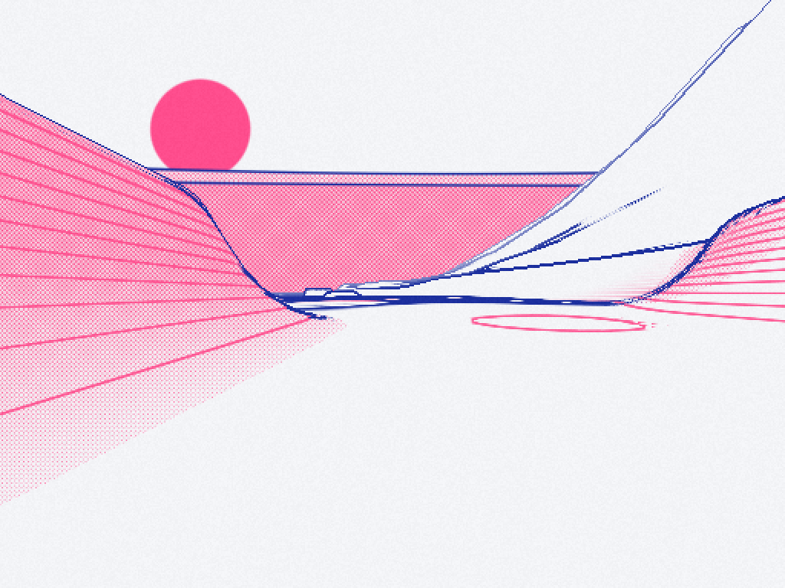

# Completing the source-faithful Falllinie port

## 1. Purpose and current boundary

Falllinie is a downhill snowboarding game whose movement, rider pose, procedural course, printed appearance and reactive soundtrack are coordinated by a browser application. The native port already runs on the RG DS Plus: it renders the original terrain and print shaders, moves a source-derived rider, accepts steering and charged jumps, follows the rider with a camera, performs airborne rotations and shows speed and provisional points.

The remaining work is not a new game design. It is the migration of the original game's still-missing state and behavior into a small native application. This guide explains the existing system, identifies its approximations and proposes an implementation that keeps the source recognizable without adding a general-purpose engine framework.

**Baseline:** playable mechanics at native commit `e68c9cb`, followed by dual-view/sky correction `cec4fcd`; first-playable commit `10a87f0` and graphics qualification `5a68fa7` remain earlier checkpoints. The frozen source is `fixtures/falllinie.html`. The user's spelling “fallline.html” refers to this already supplied Falllinie input; no second source file has been substituted.

**Delivery scope of this ticket:** the guide and its reMarkable delivery are documentation work. The implementation phases below remain work to do. A finished guide is not evidence that the soundtrack, objects or final human playtest are complete.

**Working rule:** implement coherent features, run a narrow build check when needed, and reserve the physical acceptance session for one integrated playtest after the features are present. Do not repeat the previous static graphics matrix or build a new exhaustive parity program before allowing gameplay progress.

## 2. Understand the system through one jump

A simulation tick advances game state by a fixed amount of time. Here that amount is 1/120 second. A rendered frame displays the latest state; it may contain several simulation ticks. An audio frame is one sample instant for the stereo audio output, at the negotiated sample rate. These are different units and must not share one counter.

The rider has a physical position and velocity, a board orientation, and a mode such as ground, air, rail or bail. A quaternion represents orientation without treating several rotations as interchangeable scalar angles. A pose describes where the torso, hands, feet and board sit relative to that orientation. Inverse kinematics, or IK, computes a joint position from the limb lengths and target position. The renderer converts the resulting world-space body parts into geometry.

The procedural course is divided into 110-metre cells. Cell definitions provide terrain parameters and feature locations. A mesh samples those definitions into vertices and triangles for the GPU. Object definitions describe rails, trees and gates; their collision data must be derived from the same definitions used to draw them.

An ordinary charged jump shows how the parts interact:

1. Input reports that the jump button is held. Fixed ticks accumulate charge and crouch.
2. Releasing the button adds the source's normal-directed pop velocity and enters air mode.
3. Air input changes spin/flip velocities. Releasing rotation input selects a completion target.
4. The pose places hands and feet using the current grab and orientation; the camera follows physical motion, not the displayed trick rotation.
5. Audio emits the pop sound and changes its continuous ride parameters. Later, sustained airtime attenuates drums and closes the music filter.
6. Contact with terrain evaluates uprightness and travel alignment. A valid landing produces a trick result; an invalid one clears the combo and enters bail mode.
7. HUD and audio consume that result once. The simulation remains the owner of scoring and state transitions.

```text
Controller / keyboard
         |
         v
InputState -> fixed-step Game -> GameFrame
                    |               |
                    |               +--> pose + camera + HUD
                    |                         |
                    v                         v
              Game events                GLES rendering
                    |
                    +--> audio commands -> SDL audio callback

World definitions -> collision queries
         |
         +--> incremental cell builder -> GPU cell meshes
```

This diagram describes the proposed completed design. The current code directly reads `Game` inside `Renderer::update_player` and prints several events to stdout. The explicit event/frame boundary is a small migration, not an existing subsystem being assumed.

## 3. Repository orientation and evidence

Work in:

```text
/home/manuel/code/wesen/2026-10-12--falllinie-spike
```

The authoritative original HTML has SHA256:

```text
cb9b4befd0252859d9c45246f94fbd7dd1662c6d034c6ccb95fbe16947e8b556
```

| Current native file | Role | Important limitation |
|---|---|---|
| `src/main.cpp` | SDL context, input, fixed-step loop, placement, timing | UI actions and gameplay input are still coupled |
| `src/game.hpp` | Ground/air physics, landing checks, provisional score | Inline implementation; missing source modes and full scoring |
| `src/quaternion.hpp` | Quaternion axis/multiply/rotate/slerp/frame operations | Source fallback conventions must remain explicit |
| `src/terrain.cpp` | Heights, normals, features and mesh generation | No rail/tree definition API yet |
| `src/game_renderer.cpp` | Following camera, rider transformation, patch updates | Rebuilds four cells synchronously at a boundary |
| `src/renderer.cpp` | Scene/print/presentation, native HUD, resources | Player graphics still use baked neutral poses |
| `scripts/generate-rider.cjs` | Evaluates original pose/IK/draw functions offline | Three crouch poses, not live grabs or uber poses |
| `assets/rider-poses.bin` | Three source-derived poses and draw groups | Not a replacement for the complete runtime rig |
| `assets/hud-font.*` | Original embedded IBM Plex Mono atlas | ASCII repertoire; richer text needs deliberate handling |
| `scripts/build-device.sh` | Docker ARM64 compiler and target SDL linkage | Direct build currently selects `src/*.cpp` |
| `scripts/deploy-device.sh` | Atomic executable replacement and assets | Does not itself perform a physical playtest |

The target has a measured GLES 3.2 context on Mali-G52. GL functions are obtained through `SDL_GL_GetProcAddress` after context creation. SDL/GL access stays on the main thread. The compositor worker uses Sway IPC only and starts after first presentation. Do not change this working startup order while adding gameplay features.

Existing evidence is sufficient to start implementation. `evidence/playable-run.log` shows a moving rider crossing a cell boundary. `evidence/tricks-hud-fixed-run.log` shows automated 180-degree landings and a 12-second run with p95 18.33 ms. That is automated execution, not a verdict about physical controls, sound or full-game pacing.

## 4. Original-source reading map

Line references below belong to the frozen HTML, not a downloaded newer version. Read the listed functions before porting their behavior; keep their names recognizable in C++ where practical.

| Source location | Read for |
|---|---|
| 302–373 | Vectors, matrices and quaternion conventions |
| 377–487 | Hash/RNG, cell parameters, features, drops and height |
| 493–537 | `railsOf`, `treesOf`, hazard placement |
| 539–653 | Original scene and print shaders |
| 664–701 | Interleaved mesh builder and GPU upload layout |
| 704–730 | Rows, `finishTerrain`, `workJob` |
| 731–755 | Object trees, rail supports and survey gates |
| 802–846 | Constants, input/run/rider state, reset and course placement |
| 850–938 | Tick routing, ground forces and takeoff |
| 939–1024 | Air rotation, grabs, uber transitions and landing |
| 1025–1060 | Trick score, repetition, combo addition/banking/timer |
| 1063–1129 | Rail entry/ride/exit, tree collision and bail |
| 1134–1161 | Spray particles and board trail |
| 1163–1248 | Limb dimensions, two-bone IK, base/uber pose and world rig |
| 1251–1451 | Reactive `Music`, synthesis, section scheduler and effects |
| 1457–1499 | Live trick, landing, banner, score and meter feedback |
| 1506–1557 | Keyboard/gamepad input mapping |
| 1583–1672 | Camera, palettes, glyphs and framebuffer setup |
| 1676–1761 | Rider primitive draw calls and scene/print uniforms |
| 1763–1773 | Cell lookahead and retirement |
| 1795–1814 | Fixed-step accumulator and visual interpolation |

Start with the tick routing, then ground/air state, then the rig. The audio implementation should be read as both a musical scheduler and a signal-processing graph. Reading only its public methods would miss most of the soundtrack.

## 5. Current behavior versus completed behavior

### Already available, but not yet source-complete

The current ground implementation retains source gravity, projected surface acceleration, edge grip, drag, braking/tucking and charged pop. Air mode has the source spin/flip control rates and completion rules, takeoff-axis composition and terrain-normal leveling. Landing uses the principal upside-down, sideways and sketchy thresholds.

The current character retains original primitives, limb geometry and material IDs through baked source poses. The camera uses the source direction blending, offsets, damped springs and speed-dependent field of view. The native HUD uses the source's embedded font rather than a substitute font.

### Gaps that affect play, not just implementation neatness

- Source run modes are implicit booleans/timers rather than complete ground/air/rail/bail state.
- Short-flight return behavior, fakie state, exact bail physics and course placement are incomplete.
- Raw landing points are added directly to score; combo banking and repetition penalties are missing.
- Grabs, tweak, adrenaline/boost, uber sequences and Grotesk state are missing.
- The displayed pose lacks source `qVis`, steering lean, hand targets and live IK.
- The whole-patch rebuild is synchronous; terrain may hitch at a cell boundary.
- Rails, tree hazards, gates, trails and spray are not drawn/handled as complete gameplay systems.
- Audio is absent. Previous demo music is unrelated and must not be substituted.
- Physical control feedback has not been collected. Automated input does not establish how the game feels.

The existing HUD slowdown was fixed with glyph-sized rectangles. Keep that correction: the first overlay drew a fullscreen primitive for every character and produced p95 105.445 ms. The bounded geometry version returned to p95 18.33 ms. Future HUD changes must retain bounded raster coverage.

## 6. A small target architecture

The design should have clear owners without converting the port into an entity/component framework. Move the growing inline simulation into `game.cpp`; retain a compact `game.hpp` contract. Add focused source-shaped files only where ownership or data reuse requires them.

```text
src/
  main.cpp           SDL lifecycle and integration loop
  game.hpp/.cpp      run/rider states and source mechanics
  world.hpp/.cpp     cells, rails, trees, collision queries
  pose.hpp/.cpp      source base/uber pose and IK
  score.hpp/.cpp     trick labels, repetition and combos
  feedback.hpp       compact frame/event records
  audio.hpp/.cpp     SDL audio device and command interface
  audio_dsp.*        voices, envelopes, filters and effects
  audio_score.*      original section/step arrangement
  streaming.*        one cooperative cell-generation job
  renderer.*         scene, objects, rider, HUD and print
```

These are proposed files, not a demand to split every function before implementing it. For a small first slice, score/pose helpers can remain adjacent to `game.cpp` until their interfaces stabilize. Update both CMake and the direct cross-build when adding nested source directories or a C dependency; `src/*.cpp` will not compile nested DSP files automatically.

### Proposed main-thread contracts

```cpp
struct InputState {
    float steer, drive;
    bool jump, boost;
    uint8_t grabs;                 // original 1,2,4,8 bitmask
};

enum class RiderMode { Ground, Air, Rail, Bail };

struct GameFrame {
    RiderView rider;               // physical + interpolated pose inputs
    CameraView camera;
    HudView hud;                  // live trick/result/combo/meter
    RideSoundState sound;         // continuous carve/wind/air/grind
};

struct GameEvent {
    EventKind kind;
    float intensity;
    TrickResult result;           // owned main-thread data
};

void Game::step(const InputState&, double fixed_dt);
GameFrame Game::frame(double real_dt);
EventSpan Game::take_events();
```

Names and structures are sketches. Their purpose is to prevent the renderer/audio layer from becoming the owner of score or mode transitions. Main-thread event records may contain strings for the HUD. Convert those records to plain numeric commands before handing them to the audio callback.

```text
One physical release / landing
             |
             v
Simulation transition and score change
             |
             v
One GameEvent
        /             \
       v               v
HUD result timer     Audio command
```

Drain events once per displayed frame after all fixed ticks. Do not dispatch the same landing from both collision handling and renderer inspection of `airborne`. That would duplicate points, sounds and feedback.

## 7. Complete airborne, landing and visual state

Preserve the original distinction between accumulated trick angles, physical orientation and visually interpolated orientation. A landing evaluates the physical quaternion. The renderer uses `qVis`, smoothed toward that quaternion at the source rate: 14 on ground and 40 otherwise. Source steering visualization also smooths at rate 8.

The existing airborne control is a useful baseline, but the completed port must include the entire `AirState`: elapsed time, spin/flip and velocities, nullable goals, takeoff quaternion, flip axis, accumulated grabs/tweaks, current/completed uber actions, switch/fakie flags, tricked/ollie flags and peak height.

```text
Ground -- pop / surface falls away --> Air
Air -- eligible rail contact --------> Rail
Air -- valid terrain contact --------> Ground
Air -- invalid alignment ------------> Bail
Rail -- exit / released jump --------> Air
Any ride mode -- tree/failed trick --> Bail
Bail -- source recovery -------------> Ground
```

Translate `stepRider` routing explicitly. When `groundStep` initiates takeoff, do not also run `airStep` in the same tick; the source chooses the mode branch before executing it. When rail/bail handling returns, do not continue ordinary integration and collision handling as though still in air mode.

Landing computes the board's up direction against the contact normal and its projected nose direction against tangential travel. Retain the source thresholds:

- Bail when up alignment is below 0.28.
- At speed above 4 m/s, bail when absolute nose/travel alignment is below 0.36.
- Sketchy when up is below 0.65 or absolute travel alignment below 0.75.
- Perfect when up exceeds 0.94 and absolute travel alignment exceeds 0.95.

Retain the short-flight, untricked early return and unfinished-uber rule. Set fakie from negative travel alignment. Replace the prototype's fixed 1.4-second recovery with source `doBail`/`bailStep`: angular tumble, contact response, decaying angular velocity and recovery after 1.8 seconds.

Audit fallback vectors deliberately. The original `norm` allows a caller-specified fallback; the current generic native normalizer defaults upward. Zero horizontal velocity, projected nose or IK pole must use the source's forward/pole fallback, not silently become an upward direction.

### Proposed integration loop

```text
elapsed = min(real_elapsed, 0.05)       # original browser cap
read physical input once
process pause/restart/quit actions
if playing:
    accumulator += elapsed * source_time_scale
    at most 12 times:
        if accumulator < 1/120: break
        game.step(input, 1/120)
        game.combo_tick(1/120)
        accumulator -= 1/120
    if tick cap reached: accumulator = 0
    step particles with scaled elapsed
update qVis, steering visualization and UI timers
advance cooperative course builder
compute source camera and rig
publish continuous sound state + one-shot events
render and swap
```

This restores the source's bounded tick loop and slow-motion behavior. Audio time remains independent; a source slow-motion effect does not automatically slow the soundtrack's sample clock.

## 8. Live pose, grabs and uber actions

A grab changes hand/board targets and limb geometry, not only the name displayed on screen. Keep the original `GRABS` bitmask precedence and target coordinates. Preserve left/right hands, method/tweak offsets and the source's time thresholds for counting a grab.

The source supports bit combinations, not four independent score buttons. `grabFor` first accepts an exact known mask, then searches its ordered fallback masks. Changing that order changes which trick appears when several buttons are held.

Replace three baked poses with runtime `basePose`, `bindFeet`, `ik2`, `uberPose`, `blendPose` and `computeRig`. Keep primitive meshes reusable; update transforms rather than regenerating sphere/cylinder topology every frame.

Two-bone IK uses the hip/shoulder position, target foot/hand, two segment lengths and a pole direction. Clamp reach to `(abs(l1-l2)+epsilon, l1+l2-epsilon)` before solving the triangle so fully extended or coincident targets do not produce invalid angles.

```text
input + charge + lean + grab/tweak + uber progress
                         |
                         v
                   local source pose
                         |
           feet binding + two-bone IK
                         |
                         v
        qVis transform into world-space rig
                         |
             reusable original primitives
```

Port adrenaline/boost before uber activation. Uber triggers depend on a grab edge, boost held, meter readiness and minimum air time; polling a held button every tick must not start multiple actions. Preserve the source's completed-versus-unfinished action handling and landing penalty.

The source action set includes Helikopter, Superman Deck, Kickflip ×2, Air Split, Moonwalk and Orbit. Grotesk follows the seven-letter progression and affects time/state, audio acid/hats and print inversion. Integrate these effects through explicit state rather than allowing the HUD or audio callback to modify simulation state.

### Control mapping: preserve source actions, adapt raw indices

| Action | Proposed raw RG DS binding | Source keyboard reference |
|---|---|---|
| Steer / air spin | Stick x or dpad 15/16 | Left/right or A/D |
| Tuck/brake / air flip | Stick y or dpad 13/14 | Up/down or W/S |
| Charged jump | Button 0 | Space |
| Boost/tweak/uber modifier | Button 1 or 2 | Shift or B |
| Grab bits 1,2,4,8 | Buttons 4,5,6,7 | J,K,U,I |
| Pause/resume | START 9 | P / Escape in browser |
| Restart | SELECT 8 alone, proposed | Native R / source restart button |
| Quit port | SELECT+START | Native ESC |
| Palette / mute | Y 3 / spare action or keyboard | C / M |

Browser standard dpad indices are not the raw device indices. Keep the already measured raw 13–16 mapping. Final physical labels must be confirmed during the one final playtest. Current X/button 2 changes debug view and START restarts; these conflict with the fuller source mapping and must be intentionally reassigned and shown in the HUD.

Resolve SELECT+START before individual edge actions so the quit chord does not first restart or toggle pause. Keep debug views available through a dedicated debug binding rather than using a gameplay button needed for boost.

## 9. Source scoring, combos and feedback

The prototype's direct `score += points` must become source combo behavior. A trick result contains its label, rounded points and completed uber count. A combo accumulates results, maintains a timer and banks with a multiplier. HUD feedback is a view of that state, not the implementation of it.

Retain the original formulas rather than approximating them with a new scoring table:

- Spin: `sN * 125 * (1 + 0.25*sN)`.
- Flip: `fN * 700 * (1 + 0.5*(fN-1))` when flips exist.
- Qualified grab: `200 + 450*held_time`, with the original tweak multiplier.
- Uber: `3000 + 1200*duration` per completed action.
- Airtime above 0.9 s adds `160*(t-0.9)`; spin+flip multiplies by 1.3; perfect multiplies by 1.2.
- Repetition uses the last ten labels and `0.6^repeat_count`.
- Final trick points round to the nearest five; the source rejects unlabeled/low-value results.

```text
on successful landing or rail exit:
    result = source_score_and_label(action)
    if result exists:
        combo.count += 1
        combo.sum += result.points
        combo.timer = 2.2
        meter = min(1, meter + result.points/7000)
        emit Landed(result, grade)

on ground tick:
    decrement combo timer
    when it expires:
        bank round(combo.sum * min(10, combo.count))
        emit ComboBanked
        clear combo

on bail:
    discard unbanked combo
    emit Bailed(reason)
```

Rail activity extends the timer using the source rule. Do not expire combos merely because an audio/render frame passes. Persist the best score through a small native save file as a replacement for localStorage, with an atomic temporary-write/rename; do not introduce a database.

Implement source-style live trick, landing grade, result timeout, combo, meter and banners. The original result lasts 1.7 seconds; the live label refresh lasts 0.12 seconds. Preserve dirty-label updates so formatted text/geometry are rebuilt when content changes, not unnecessarily every tick. Keep metrics inexpensive and legible at the physical screen size.

The ASCII atlas cannot directly display ×, ü or typographic separators. Either extend the atlas to the known source glyph repertoire or define a clearly documented ASCII fallback. The preferred implementation adds those few glyphs to the existing source-font export rather than changing typography.

## 10. Original reactive soundtrack: what must actually be ported

The source soundtrack is a live composition, not a WAV loop. It runs at 86 BPM, with a sixteenth-note period:

```text
S16 = 60 / 86 / 4 = approximately 0.1744186 seconds
```

A section lasts eight bars. The initial sequence is intro, verse and hook; subsequent sections choose among verse, hook, break and glitch according to source weights while avoiding immediate repeated names. Preserve the three chord progressions, chop patterns, vowel/formant tables, instrument flags, timing swing and random probability rules.

The original timbres include:

- Kick: falling sine pitch plus a short filtered noise attack.
- Snare: filtered noise plus a pitched triangle component, with crushed variants.
- Hats: high-pass noise and short/open envelopes.
- Rhodes: detuned sine carriers with frequency modulation, slow detune modulation, attack/sustain/tail and stereo placement.
- Bass: sine plus filtered triangle.
- Pad: detuned saw voices through a low-pass envelope.
- Vocal chops: detuned saw voices through three formant bands with delay/reverb sends.
- Glitch blips and Grotesk acid voices, vinyl hiss/crackle and continuous carve/wind/grind noise.

Preserve the graph as named mixing stages. A mixing stage sums its input voices, applies gain/filter processing and sends its output onward.

```text
Drums ----------------------+
Bass -----------------------+--> music lowpass --> master --+
Keys + chops --> pump ------+                              |
Delay / reverb returns -----+                              v
                                                compressor
Ride effects ------------------------------->      |
Vinyl -------------------------------------->      v
                                              saturation
                                                   |
                                                 output
```

The real source has branch-specific sends/levels: this overview is not permission to collapse every voice into one undifferentiated mixer. `Music.init()` is the authoritative routing and parameter reference.

### Reactivity that affects gameplay perception

- Carve gain depends on speed, steering and brake, quantized to 1/30 and smoothed with the source target time constant.
- Wind is a separate low-pass noise layer, also quantized and smoothed.
- Grind switches a narrow-band noise layer while rail mode is active.
- Sustained air changes drums from 1 to 0.08 and music cutoff from 9000 to 1150 Hz, with different entry/exit smoothing.
- Landing restores the air state, optionally emits a low falling impact tone and a chord-related chop sequence.
- Pop is filtered noise, not the demo pickup chime.
- Bail sweeps the music filter down to 240 Hz, schedules recovery and emits its own effect.
- Uber and Grotesk have distinct source transitions; do not represent them with a generic success beep.

Follow the original call sites. Source `takeoff` clears carve; the sustained `Music.air(true)` call happens only after airtime exceeds 0.35 seconds. Applying the music filter immediately on every tiny hop would change the source's feel.

### Proposed SDL audio design

Use one `AudioEngine` owning the device, sample clock, instrument voices, filter state and effect buffers. Open stereo floating-point audio if the installed SDL backend supports the requested format; honor the returned sample rate. The current app does not initialize `SDL_INIT_AUDIO`, so this must be added deliberately.

```cpp
bool AudioEngine::open();
void AudioEngine::set_ride_state(const RideSoundState&); // main thread
void AudioEngine::submit(const AudioCommand&);         // main thread
void AudioEngine::pause(bool);
void AudioEngine::set_muted(bool);
void AudioEngine::close();
```

Use a bounded single-producer/single-consumer command queue: main thread produces, SDL callback consumes. Commands contain enum/numeric payloads, not strings, pointers into temporary game events or GL resources. Allocate voices, noise buffers, delay lines, reverb storage and command storage before unpausing the device.

```text
SDL callback:
    clear the supplied output block
    consume queued transition commands
    for each output sample frame:
        schedule source steps whose sample deadline is due
        advance active voice envelopes/oscillators
        mix source buses and persistent effects
        write stereo samples
        increment audio sample clock
```

No filesystem access, logging, allocation, mutex waits or SDL/GL rendering belongs in the callback. Start with a bounded voice budget, proposed 128, and a deterministic voice-stealing rule; this is an initial implementation limit, not a measured proof that all source overlaps fit.

Use a fractional sample deadline for `S16*sample_rate` so repeated integer rounding does not accumulate tempo drift. Apply the source 16% offbeat swing and ±3 ms timing variation at event scheduling. Keep music random selection separate from terrain hashing; preserve its rules/distributions rather than claiming the browser's nondeterministic random bitstream can be recreated.

Audio time continues through ordinary rider restart because the browser does not restart its section scheduler in `newRun`. Pause should suspend the audio device/sample clock like AudioContext suspension. Game slow motion scales physics, not the soundtrack tempo.

### WebAudio primitives and native equivalents

| Source API | Native responsibility |
|---|---|
| OscillatorNode | Phase accumulator with source waveform/frequency/detune |
| GainNode / AudioParam | Time-indexed envelope and target smoothing |
| BiquadFilterNode | Per-voice/bus biquad with source type/cutoff/Q |
| AudioBufferSourceNode | Noise/impulse playback with source offsets/duration |
| StereoPannerNode | Source-equivalent stereo pan law |
| DelayNode | Bounded delay ring; source three-sixteenth delay and feedback |
| ConvolverNode | Partitioned convolution for the original generated impulse |
| DynamicsCompressorNode | Explicit source threshold/knee/ratio/attack/release model |
| WaveShaperNode | Source tanh/quantization transfer curves and oversampling policy |

Preserve the source noise buffers, 2.6-second stereo impulse decay and effect levels. A direct convolution over every impulse tap for every sample is not appropriate on this CPU. Use partitioned FFT convolution with preallocated storage. A small vendored FFT implementation, such as KissFFT, is a candidate; verify its license, pin its revision and add its ARM64 build inputs before relying on it. This is a proposed dependency, not an already installed capability.

Avoid using a generic reverb in place of the source impulse without explicitly deciding and documenting that audible approximation. Likewise, WebAudio compressor and oscillator implementation details do not become exact just because the native API has similar names. The final goal is the recognizable source arrangement, timbres and reactivity, with DSP approximations documented instead of hidden.

## 11. Objects, collision and rail gameplay

Put procedural definitions in `World`, using the existing seeded terrain arithmetic. Rendering and physics must share the same rail/tree data. Do not independently regenerate object positions in the renderer with another RNG stream.

`railsOf` places rail endpoints 0.8 m above the surface, samples intermediate terrain and raises the bar to maintain clearance. Retain this check or a rail can intersect a kicker. Each rail carries endpoints, unit direction and length. Tree definitions include bank placement and optional interior hazards that avoid nearby kickers/cliffs/rails according to the source exclusions.

`buildObjects` uses original box/cone geometry: two cone tiers per tree, trunks, rail bars/supports and paired survey gates at painted-number distances. Retain material/albedo and the source object scene pass rather than creating a separate visual style.

```cpp
const CellDefinition& World::cell(int id);
RailSpan World::rails(int id);
TreeSpan World::trees(int id);
float World::height(float x, float z);
Vec3 World::normal(float x, float z);
```

These interfaces are proposed views of stable cached data. Prefer IDs or owned rail state over dangling references when a cell retires. A rider on a rail must keep that rail's definition alive until exit, even if normal cache retirement would otherwise remove it.

Port source `tryRail`, `enterRail` and `railStep` together. Speed must exceed 3 m/s; contact needs the original endpoint, lateral, vertical and approach-alignment checks. Preserve 50-50 versus boardslide selection, rail gravity/friction, boost, jump-release exit, grind sound, accumulated time/points and combo extension.

Tree collisions use the source trunk radius/height rule. A bail clears unbanked combo, terminates rail/air sound state and displays its reason. Course recovery uses the original nearby-feature avoidance and safe period, not an unconditional teleport to a renderer-selected position.

Trails and particles should remain bounded as in the source, with breaks on takeoff/bail/rail transitions. They complete visible snow interaction but must not become the prerequisites for first integrating collision and scoring.

## 12. Incremental streaming without a new concurrency system

The current player update rebuilds four complete cells when the rider enters a new cell. This repeats geometry work and blocks the same thread responsible for event pumping and presentation. The source already provides the simpler replacement: one active row-generation job with a time budget.

### Decision: cooperative streaming first

- **Context:** GL belongs to the main thread; current cell-boundary work is synchronous; source has `workJob`.
- **Options:** whole-patch rebuild, a worker thread with duplicated world caches, or one cooperative row job.
- **Decision:** port the cooperative job and per-cell meshes first.
- **Rationale:** it is source-shaped, eliminates repeated whole-patch work and avoids shared-cache/data-race complexity.
- **Consequences:** upload/finalization can still create a short stall; subdivide that work only if the integrated playtest shows it.
- **Status:** proposed for this ticket.

Maintain the source visible window `current_cell-1` through `current_cell+5`, with bounded lookahead and retirement. Essential startup cells may be built before the first ride begins; subsequent generation must not freeze the event loop.

```text
CellBuildJob:
    cell_id
    next_row = -1
    sampled positions + metadata
    status = Sampling | Finalizing | Ready

frame work:
    if no active job:
        choose nearest missing needed cell
    deadline = now + proposed 3.5 ms source budget
    while job needs rows and now < deadline:
        generate one original terrainRow
        advance row
    if all helper rows exist:
        finish normals/indices
        upload this cell only
        publish cell as ready
    retire meshes outside source retention window
```

The original drawn extent is 110.4 m, with helper rows for normals and 0.4 m overlap. Do not remove that overlap while reorganizing generation. Leave the old cell visible until its replacement/neighbor is ready; absence of geometry must not become a temporary hole under the rider.

Separate CPU definitions from GPU mesh residency. Physics can evaluate a rail or surface even if its visual mesh is still being built. Trim deterministic definition caches according to source policy; keep cumulative cliff-drop semantics correct when earlier cells are removed. The main thread can own both caches and builder initially.

Build object meshes from the same cell definition and budget their work rather than adding an unbounded object-generation pass after the terrain budget. Preserve seed/generation identity on restart so an old queued job cannot publish a cell from the previous course.

Do not add a thread pool, job database or generic renderer scheduler for this. If finalization later proves expensive, first split normal/index assembly into bounded row chunks. Introduce a worker only after a real remaining bottleneck justifies its ownership cost.

## 13. Implementation order and coherent commits

The ordering below is dependency-driven, not a demand for separate validation campaigns. Each phase should produce useful integrated behavior. Keep the detailed diary at meaningful feature boundaries and capture actual failure diagnostics promptly.

### Phase 1 — finish the source run/air/landing boundary

Move simulation implementation out of the header, add explicit modes/air state, source fallbacks, fakie, exact bail/recovery and visual interpolation. Add typed transition events and pause/restart action handling. Retain existing playable behavior while replacing approximations deliberately.

**Checkpoint:** source-shaped mode routing and landing feedback; no new physical playtest yet.

### Phase 2 — runtime pose and grabs

Port source IK/base pose/uber pose with reusable primitives. Implement grab bits, held-time tracking, tweak and live names. Preserve the baked asset only as a reference until live geometry is operational.

**Checkpoint:** original rider performs actual grab poses, rather than displaying a label over the neutral pose.

### Phase 3 — scoring, meter, boost and advanced trick state

Port exact result labeling, repetition, combo timer/banking, meter, uber actions and Grotesk effects. Update HUD/persistence and the full control mapping together. Do not leave the prototype direct-score path active alongside the new combo path.

**Checkpoint:** one owner of score and feedback; intentional source behavior at pause/restart/bail.

### Phase 4 — cooperative cells, objects and rails

Replace whole-patch updates with per-cell generation/retirement. Add source objects from shared definitions, rail mode and tree collision, then bounded trail/spray. The rendering and collision course must agree.

**Checkpoint:** a continuous ride contains actual interactable course objects and does not rebuild every old cell at each boundary.

### Phase 5 — reactive original audio

Implement the sample-clock/voice/filter infrastructure, then source scheduler/progressions/instruments and effects. Wire all already available mode/trick/meter events so there is no period of “finished music” that ignores gameplay. Keep callback ownership and cleanup explicit.

**Checkpoint:** source musical arrangement and movement/air/rail/land/bail reactivity are integrated, with approximations listed.

### Phase 6 — polish the integrated ride, then one physical playtest

Finish player-visible live/result/grade/combo/meter states, pause/mute/restart, original palette/inversion transitions and meaningful failure recovery. Build/deploy the integrated version, commit its ready-for-playtest checkpoint and conduct the final session described below.

**Checkpoint:** record human observations and fixes, not another static qualification matrix.

This ordering puts streaming before the audio callback grows CPU demand. It also makes every audio event available before audio integration, reducing temporary adapters that would later be discarded.

## 14. Minimal checks and one final physical session

The objective is to get the integrated game played. Do not run exhaustive source fixtures, all resolution combinations, long soak tests, screenshot equivalence loops or synthetic input permutations after every change. Existing static qualification remains historical evidence at its own revision, not a reason to repeatedly re-qualify the platform.

Intermediate checks should answer concrete risks only:

- Build the changed native executable at a coherent boundary.
- For a real compiler/runtime failure, retain the relevant diagnostic, fix it and rerun the narrow affected operation.
- A very small check is justified for a dangerous ownership boundary, such as an invalid audio buffer size or a dangling retired rail; do not use it to expand the project into a testing program.
- Leave proposed DSP and control behavior honestly unconfirmed until integrated playtesting. Do not call an unheard soundtrack “audibly verified”.

### Final physical playtest script

One session should exercise the completed experience, not every mathematical case. Use the real handheld, normal speakers/headphones and physical controls. Record video/audio if useful and include the code revision and settings.

1. Start the port and inspect the instructions; confirm the actual face/shoulder button labels.
2. Ride straight, carve both directions, brake and tuck. Judge whether the rider and camera feel coordinated.
3. Hold/release a charged jump. Compare pop, carve reduction, sustained-air filter and landing restoration audibly.
4. Spin and flip, release to complete, then land cleanly and deliberately land badly. Check readable grade/reason and bail recovery.
5. Hold individual/combined grabs, tweak with boost and trigger a ready uber. Check pose, label, meter and source sound reaction.
6. Chain results, bank a combo, repeat a trick and bail with an unbanked combo. Check source score semantics.
7. Enter and exit a rail, jump off it, and hit a tree hazard. Verify visual/collision agreement and grind transitions.
8. Ride across several cell boundaries; note visible holes, abrupt object changes or felt hitches.
9. Pause/resume, mute/unmute and restart. Confirm music-clock continuity, absence of stuck noise and correct controls.
10. Quit back to the frontend without changing compositor policy or leaving audio running.

Record observations as “input/action → observed result → desired correction”. An automated 180 and a JSON p95 are not replacements for this account. After the session, fix observed issues together; do not restart an entire broad validation pipeline after each small correction.

## 15. API references and implementation cautions

### SDL and GLES contracts

- `SDL_Init` / `SDL_INIT_AUDIO`: initialize the added subsystem without changing the working video startup. https://wiki.libsdl.org/SDL2/SDL_Init
- `SDL_OpenAudioDevice`: request/inspect the obtained format, frequency, channels and callback. https://wiki.libsdl.org/SDL2/SDL_OpenAudioDevice
- `SDL_AudioSpec`: callback receives a byte length, not a count of stereo frames. Divide by channels and bytes per sample. https://wiki.libsdl.org/SDL2/SDL_AudioSpec
- `SDL_PauseAudioDevice`: stop/start callback processing; newly opened devices start paused. https://wiki.libsdl.org/SDL2/SDL_PauseAudioDevice
- `SDL_CloseAudioDevice`: stop callback use before freeing userdata, DSP buffers or command storage. https://wiki.libsdl.org/SDL2/SDL_CloseAudioDevice
- `SDL_GetPerformanceCounter`: budget cooperative row work using monotonic timing. https://wiki.libsdl.org/SDL2/SDL_GetPerformanceCounter
- `SDL_JoystickGetButton` / `SDL_JoystickGetAxis`: raw device indices are not browser standard gamepad indices. https://wiki.libsdl.org/SDL2/SDL_JoystickGetButton
- `SDL_GL_GetProcAddress`: retain the current target-compatible GL loading boundary. https://wiki.libsdl.org/SDL2/SDL_GL_GetProcAddress
- GLES `glBufferData`, `glBufferSubData`, `glDeleteBuffers`, `glDeleteVertexArrays`: upload/retire cell and dynamic rider resources on the main thread. Reference index: https://registry.khronos.org/OpenGL-Refpages/es3.0/
- GLSL ES precision rules: keep the existing explicit highp print depth sampler; do not reintroduce the Mali false-edge bug while changing programs. Specification: https://registry.khronos.org/OpenGL/specs/es/3.0/GLSL_ES_Specification_3.00.pdf

### Audio semantics references

The original HTML remains the authority for musical data and parameters. Use the Web Audio specification and AudioParam documentation for automation semantics, not as permission to replace source values:

- https://www.w3.org/TR/webaudio/
- https://developer.mozilla.org/en-US/docs/Web/API/AudioParam
- https://developer.mozilla.org/en-US/docs/Web/API/BiquadFilterNode
- https://developer.mozilla.org/en-US/docs/Web/API/ConvolverNode
- FFT implementation candidate requiring source/license review and pinning: https://github.com/mborgerding/kissfft

These are reference URLs, not claims that a new dependency was fetched, vetted or built in this documentation turn. Read the already archived SDL/GLES/spec material in the prior graphics ticket before repeating broad web discovery.

## 16. Risks and deliberate non-goals

The largest fidelity risk is replacing source systems with simplified effects that look plausible in a short recording. Neutral baked poses, immediate raw points, generic music and unconditional course teleporting all reduce the original relationships between input, trick, landing and feedback. Replace these consciously in the implementation phases rather than treating the existing prototype as a complete model.

The largest responsiveness risks are whole-cell finalization/upload, unbounded HUD geometry and audio DSP work that exceeds its callback interval. Their owners and limits should remain explicit. Starting with cooperative generation and preallocated audio state keeps the design small; it does not guarantee performance before the integrated playtest.

A separate second-screen game simulation and a new UI/game design are not prerequisites for this ticket. The user's subsequent request adds a lower-screen first-person rendering of the same ride, implemented at `cec4fcd`; retain this shared-state extension while completing the original mechanics. Section 18 explains its ownership and future pose integration.

Do not claim sample-identical WebAudio synthesis, complete source parity, physical control usability or final audible quality before the corresponding implementation and human observation exist. The desired outcome is a playable, recognizable native Falllinie with documented remaining approximations—not a larger collection of test receipts.

## 17. Intern completion checklist

Before requesting the one final physical session, the intern should be able to point to:

- Source mode routing, exact landing/bail/course-recovery behavior and visual interpolation.
- Runtime source rig and real grab/uber poses.
- Source score/repetition/combo/meter rules and clear HUD results.
- Shared object/collision definitions with rail and tree gameplay.
- Cooperative per-cell building and bounded retirement, replacing synchronous patch rebuilds.
- Original 86 BPM arrangement, timbres/effects and mode/event-driven audio changes.
- Working pause/mute/restart/quit and the displayed physical control mapping.
- A coherent implementation commit and detailed diary explaining actual departures and failures.

The physical session then supplies the missing evidence about feel, audibility, control labels and integrated behavior. Until that session occurs, the physical-playtest task remains open.

## 18. Added requirement: lower-screen first-person view

The user subsequently requested a first-person rendering on the lower screen. This is implemented at `cec4fcd` as a second SDL window, not a second rider or physics loop. Top DSI-2 retains the chase view and HUD. Bottom DSI-1 renders a head-level view of the same world without drawing the rider's own face or duplicating the HUD.



*Actual DSI-1 compositor capture of the running native application.*

### Current ownership

One GLES context is made current to each compatible SDL window in sequence using `SDL_GL_MakeCurrent`. The actual target run confirms this arrangement works on the installed SDL/Wayland/Mali path. Geometry and textures remain in that context; the current offscreen scene/print targets are reused serially. No GL calls move to the IPC worker.

```text
One fixed-step Game
         |
         +--> source pose / shared world meshes
                         |
            +------------+------------+
            |                         |
      chase camera                head camera
            |                         |
      render + swap              render + swap
            |                         |
          DSI-2                     DSI-1
```

Both surfaces receive their first swap before the placement worker searches for them. It moves exact titles `falllinie:spike` and `falllinie:firstperson` to their outputs and keeps input focus on the top view. The first-person pass restores the primary camera/state after rendering. An explicit primary redraw occurs before a requested top-view framebuffer capture, because the shared print texture was last written by the lower view.

The current first-person anchor is the center of the source-generated head geometry, transformed by rider orientation. It looks along board nose and uses a 78-degree field of view. This is an intentional extension, not a camera present in the original HTML. Runtime rig integration should later supply the actual head anchor and a deliberate head-versus-travel orientation policy. Keep the choice explicit, especially for fakie, grabs, flips and bails; do not silently make the lower camera follow unrelated velocity while calling it head orientation.

A short dual-view run completed 277 frames in eight seconds with p95 30.38 ms and GL error 0; it predates the final integer-precision correction described below and is an integration observation, not a fresh full-platform qualification. Human comfort during spins/flips and the completed audio/object workload remain part of the one final playtest.

API reference: https://wiki.libsdl.org/SDL2/SDL_GL_MakeCurrent . Keep the single-context sequential arrangement unless an observed limitation justifies extra contexts; separate contexts require deliberate resource sharing and additional lifetime rules.

### Mountain-contour discontinuity correction

The user also reported disconnected background mountain segments. These contours are generated in the print shader, not by streamed terrain triangles. The original large sine hash was replaced in compiler input with an explicitly high-precision unsigned integer hash over a wrapped angular lattice. Layer amplitudes, colors and interpolated silhouette construction remain source-shaped, but the random silhouette realization intentionally changes.

Wrapping addresses the atan angle boundary when the first-person camera turns backward. Explicit `highp uint` is essential: the first attempt's default integer precision flattened the variation on Mali. The corrected capture has continuous varied contours. This is a documented compatibility change; it does not prove the exact compiler transformation responsible for the original visible jumps. `--source-sky-hash` retains the original function for comparison, and the archived source shader file is unchanged.

Current implementation points: `src/main.cpp`, `Renderer::render_first_person` in `src/game_renderer.cpp`, and compile-time source adaptation in `src/renderer.cpp`. The launcher now includes `--dual-screen`. Do not add a second audio instance, scoring path or streaming job for the lower view.
