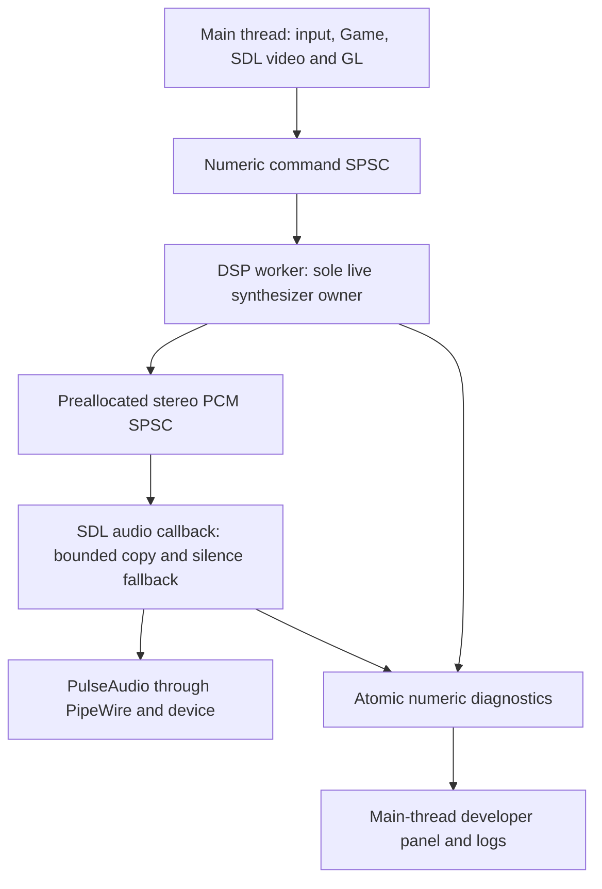
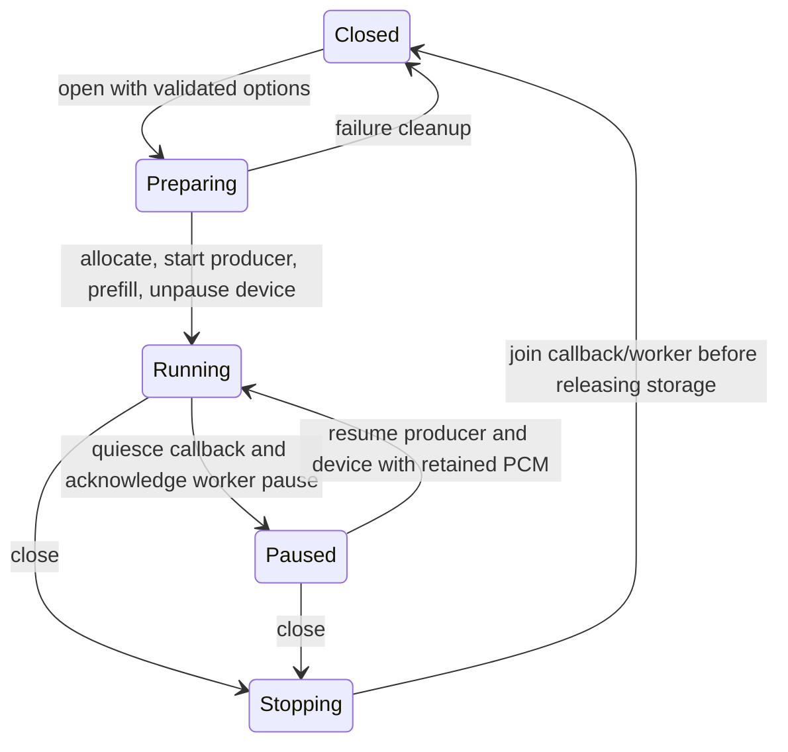

# Native audio timing: analysis, design and implementation guide

## 1. Purpose and current status

Falllinie is a C++17/SDL2/OpenGL ES port of a browser snowboarding game on the Anbernic RG DS Plus running ROCKNIX. Its soundtrack is synthesized: numerical oscillators, envelopes, filters and effects generate stereo samples while the game runs. The application does not simply decode a prerecorded soundtrack. This guide explains how those samples currently reach the device and how to move expensive synthesis out of the deadline-sensitive SDL callback without creating another owner of musical state.

The implementation base is native revision `f5ab7b1` in `/home/manuel/code/wesen/2026-10-12--falllinie-spike`. At this checkpoint SDL's callback still runs the complete DSP graph. The proposed worker and PCM transport described below are not yet implemented. Completion must be recorded through tests, review and target evidence, not by changing this sentence into an unsupported acceptance claim.

Two independent issues motivated the work. The user heard crackling, and the callback instrumentation measured occasional wall-time overruns. A matched pre-rendered A/B test subsequently removed only the source's intentional vinyl-noise contribution; the user said the second playback worked without crackles, tentatively. That supports making vinyl optional, but does not resolve the separately measured timing risk. This ticket owns the timing architecture, its instrumentation and lifecycle tests; it also carries the small vinyl preference needed for clean handheld playback.

The first implementation will use a dedicated DSP thread in the same process, a preallocated single-producer/single-consumer PCM buffer, and a callback that only copies ready samples and reports counters. It will retain the offline renderer and an explicit direct-callback reference mode for comparisons. A separate process, mandatory CPU affinity, real-time scheduling and replacement of the source reverb are not first-slice requirements.

## 2. Definitions in dependency order

An **audio sample** is one numerical amplitude for one channel at one instant. An **audio frame** contains the samples for all channels at that instant. Stereo float output therefore uses two 32-bit values per frame: 1,024 frames contain 2,048 values and occupy 8,192 bytes. A sample rate of 48,000 frames per second makes 1,024 frames last approximately 21.333 milliseconds.

**Pulse-code modulation (PCM)** is the sequence of those numerical audio samples. Here it is interleaved stereo float PCM: `L0,R0,L1,R1,...`. The **SDL callback** receives writable memory and a byte count from the backend and must fill that memory promptly. It must not assume every request has the same length merely because the desired device buffer was 1,024 frames.

**Digital signal processing (DSP)** is the computation that turns musical state and input controls into PCM: oscillators, envelopes, filtering, mixing and effects. A **producer** computes ready PCM. A **consumer** removes PCM for playback. A **single-producer/single-consumer queue (SPSC)** permits exactly one writer and one reader; its safety depends on those owners remaining unique.

A **deadline** is the time allowance associated with supplying the next audio buffer. This application currently compares measured callback wall time with the nominal duration `frames / sample_rate`. An actual backend/device underrun is a separate observation: backend buffering and scheduling affect whether an application overrun becomes audible. A **queue starvation** in the new design means the callback asks for more ready PCM than the application queue contains. It is not automatically a driver XRUN either.

**Wall time** measures elapsed time, including intervals when a thread is not scheduled. **Thread CPU time** measures time spent executing that thread. If a block takes 30 ms wall time but 12 ms thread CPU time, the missing 18 ms cannot be described as DSP computation. It may include scheduling or blocking; further evidence is required to identify the cause.

## 3. System orientation: a pop reaches the speaker

The main thread reads SDL input and updates one authoritative `Game`. Physics runs in 1/120-second ticks through `NativeFrameClock::advance`. `Game::begin_frame` determines scaling before those ticks; `real_time_feedback` updates continuous ride sound using raw elapsed frame time. Neither the chase nor first-person render view owns another simulation.

Suppose a rider pops from the ground. The game updates its motion and emits a `Pop` event. `publish_feedback` in `src/runtime.cpp` sends numeric ride state and the event to `AudioEngine`, then clears the main-thread event vector. UI strings remain in the main thread; the audio command stores the numeric fields needed to choose a sound voice. The engine's sample clock determines when that voice begins.

At the current checkpoint, the SDL callback drains commands and computes the next samples. In the new architecture, the DSP worker performs that operation ahead of consumption, while SDL copies already-generated PCM. The event can therefore be heard later by approximately the queued lead in addition to existing DSP/backend delays. This is an explicit consequence to measure, not an invisible implementation detail.



This is the target design. The current command queue exists, but the PCM queue and DSP worker do not yet exist at the base revision. One worker is sufficient: introducing several producers for individual voices would invalidate the SPSC model and require a new mixing/synchronization design.

## 4. Read these source paths first

| Path / API | Responsibility | What an intern should verify |
|---|---|---|
| `src/audio.hpp`, `AudioEngine` | Public lifetime, control, offline rendering and diagnostics | Calls are permitted in the correct lifetime/thread mode. |
| `src/audio.cpp`, `Impl::prepare` | Allocate/init noise, voices, envelopes, filters, delay, reverb and saturation | No callback allocation; correct reset/reopen behavior. |
| `src/audio.cpp`, `Impl::render` | Advance sample clock and generate interleaved stereo | Remains one DSP implementation, reused by live worker and offline tests. |
| `src/audio.cpp`, `Impl::callback` | Current synchronous DSP plus aggregate callback timing | Replace live computation with bounded transport in buffered mode. |
| `src/audio.cpp`, command enqueue/consume | Numeric controls/events | Main remains producer; DSP owner becomes consumer. |
| `src/audio_dsp.hpp`, `Reverb`, `FFT`, `planar_accumulate` | Partitioned stereo convolution | Preserve full response, phase/history and wet latency. |
| `src/audio_dsp.hpp`, oscillator/envelope/filter/saturation helpers | Per-voice and bus processing | Avoid changing sound while changing transport. |
| `src/runtime.cpp`, `publish_feedback` | One effective ride state and event drain per frame | No duplicate event publication or queue growth while paused. |
| `src/main.cpp` | Open on gameplay start, pause/resume, close and diagnostic capture | Main-thread lifecycle stays authoritative. |
| `src/developer_overlay.*` | Cached source-font diagnostic formatting | Distinguish queued/produced/consumed samples and starvation from XRUNs. |
| `tests/test_audio.cpp` | Numerical, arrangement, reactivity, allocation and block checks | Offline behavior must remain reproducible. |
| `tests/test_audio_lifecycle.cpp` | Dummy SDL device/lifecycle checks | Exercise buffered start, pause, close, reopen and owner teardown. |
| `scripts/falllinie-spike.sh` | Handheld launcher | Explicit selected buffer and vinyl preference, no hidden graph reduction. |

Use the game ticket `FALLLINIE-GAME-002` for previous source integration and coordinate/render work. The new ticket must not claim that changing audio transport fixes the integrated approximately 50 FPS renderer.

## 5. Current numerical work and why FFTs appear

The engine mixes a bounded pool of 128 voice slots, supports a 256-command queue and has 64 bounded pump entries. Voice rendering includes source-derived instrument oscillators, envelopes and filters. Continuous carve/wind/grind effects, generated noise, delay, stereo reverb, compression and 2x saturation contribute to the final output. Active voice indices are sorted so skipping empty slots preserves the previous ascending-slot summation order.

The long reverb is **convolution**, not an oscillator. An impulse response `h[k]` describes the contribution of earlier input to the current output:

```text
y[n] = sum over k of h[k] * x[n-k]
```

The native impulse response lasts 2.6 seconds, or 124,800 samples per channel at 48 kHz. Directly evaluating that sum at every sample would require roughly six billion multiplications per second per channel. A Fast Fourier Transform (FFT) converts a block into frequency values so convolution can be performed as spectral multiplication. Its inverse returns a time-domain block.

`Reverb` uses 1,024-sample partitions and 2,048-point transforms. At 48 kHz there are 122 partitions. Real-valued input/response spectra have Hermitian symmetry, allowing only 1,025 independent bins to be stored. The implementation reconstructs the conjugate half before inverse transformation and uses overlap-add to combine successive output blocks. It retains one partition of explicit wet latency: 1,024 samples, or 21.333 ms at 48 kHz.

Most delayed partitions depend on already completed input history. The existing optimization distributes their multiplication in 64-sample groups rather than doing every partition at the block boundary. Partition zero, the current input FFT and the inverse FFT still require the current completed block. This reduces bursts without deleting the tail, but does not remove all computational cost.

The source impulse response, musical arrangement, seeded state, filters and 49-tap half-band saturation remain outside this ticket's optimization scope. Transport changes must not replace them with cheaper unrelated effects or alter RNG consumption. Making vinyl inaudible must continue generating/filtering its source state so downstream response initialization and deterministic state do not change accidentally.

## 6. Evidence: average completion is not a guarantee

The existing target is PulseAudio through PipeWire, observed at 48 kHz floating-point stereo. SDL's old desired buffer was 512 frames; the current handheld launcher requests 1,024. The actual obtained buffer is recorded. Both main and audio threads were eligible for CPU cores 0–3; they were not pinned apart. The measured SDL audio thread had normal scheduling and nice -20, not a qualified real-time policy.

| Investigation | Buffer frames | Mean callback ms | Maximum ms | Over-budget / callbacks |
|---|---:|---:|---:|---:|
| Integrated baseline | 512 | 8.84164 | 23.9911 | 521 / 1,053 |
| Half-spectrum arithmetic | 512 | 6.67424 | 19.0377 | 178 / 1,320 |
| Distributed partitions | 512 | 7.61094 | 17.6165 | 112 / 2,754 |
| Planar vectorized arrays | 512 | 7.73134 | 15.5368 | 99 / 2,752 |
| Sorted occupied voices | 512 | 6.34155 | 15.0859 | 19 / 2,786 |
| Overlay and larger buffer | 1,024 | 12.2459 | 39.8702 | 3 / 2,574 |

These are sequential runs with different durations/song phases, not a controlled same-workload causal benchmark. The nominal budgets are 10.6667 and 21.3333 ms respectively. The last maximum still exceeds its budget. Queue drops/steals/nonfinite counts were zero in those quoted runs. None of these counters is a confirmed backend XRUN count.

A previous diagnostic profile attributed 17.45% of sampled events to `voice_sample` and 11.45% to `planar_accumulate`; those profile shares are not current per-callback utilization or additive wall-time percentages. The worker must gather wall/CPU timing in the new arrangement rather than assume every late callback was computing continuously.

The source vinyl layer is a separate signal component. The controlled test used identical pre-rendered excerpts and zeroed only its 0.22 mix coefficient in the second excerpt; no live synthesis occurred during playback. The user's response was “the second play worked without crackles I think...”. Keep that uncertainty and scope. This evidence supports a preference option, not a claim that all timing problems are solved.

## 7. Architecture decisions

### Decision: same-process DSP worker

- **Context:** SDL's callback currently pays the full synthesis cost, including block-boundary operations.
- **Options considered:** pin existing callback, move synthesis to a thread, or move it into a process with shared memory.
- **Decision:** first implement one same-process worker and a PCM queue.
- **Rationale:** it reuses the existing numeric command transport and synthesizer without adding shared-memory process lifecycle or serialization.
- **Consequences:** queued audio adds latency; startup, pause, stop and starvation become explicit contracts. The worker still needs enough average throughput.
- **Status:** accepted implementation direction; target acceptance pending.

### Decision: callback never waits for synthesis

- **Context:** blocking for a producer inside the callback reintroduces the very deadline risk being removed.
- **Options considered:** mutex-protected queue, condition-variable wait, or bounded lock-free consumption with silence on shortage.
- **Decision:** callback copies available PCM, zero-fills any missing remainder and increments separate starvation counters.
- **Rationale:** bounded completion and initialized output are preferable to unbounded waiting or stale/replayed samples.
- **Consequences:** starvation remains audible and must fail normal-playback acceptance. Silence fallback is damage containment, not successful playback.
- **Status:** required invariant.

### Decision: finite lead rather than filling the entire queue

- **Context:** a large queue can hide scheduling stalls while making pop/landing feedback noticeably late.
- **Options considered:** fill all storage, fixed two-block lead, or a target derived from obtained SDL request size.
- **Decision:** use a small lead that covers the obtained callback request plus refill margin, ordinarily around two 1,024-frame blocks for a 1,024-frame device request. Capacity can be larger than the fill target.
- **Rationale:** bounded headroom and latency should be observable and controlled separately.
- **Consequences:** a 4,096-frame request requires a larger target than two blocks. Expose queue depth and document actual target; validate partial reads and all allowed buffer sizes.
- **Status:** accepted policy; exact constants/API names to be finalized by implementation and recorded.

### Decision: preserve source mix, make vinyl preference explicit

- **Context:** the user identified the no-vinyl excerpt as cleaner, while source fidelity remains important.
- **Decision:** library/offline defaults preserve source vinyl; the handheld launcher can explicitly disable it. Provide an explicit source-vinyl override and diagnostic visibility.
- **Rationale:** disabling an authored noise component is a documented preference adaptation, not a falsely described DSP bug fix.
- **Consequences:** keep source-state generation and default regression behavior intact; test the preference independently of buffering.
- **Status:** accepted small companion change.

### Decision: defer forced affinity and real-time policy

- **Context:** current threads can use all four cores, but timing data does not yet distinguish computation from descheduling.
- **Decision:** add wall/CPU evidence first. Parent may run a bounded affinity comparison after functional acceptance; no permanent kernel/system policy changes in this slice.
- **Rationale:** pinning does not reduce arithmetic, and inappropriate real-time policy can degrade system responsiveness.
- **Consequences:** scheduling experiments must record exact masks/policy and restore them; they cannot substitute for transport correctness.
- **Status:** deferred experimental option.

## 8. Ownership and memory model

The main thread owns device lifetime, user preferences, pause requests, and the producer side of the numeric command queue. In buffered mode the DSP worker exclusively owns oscillator phases, RNG, voices, musical sample clock, filters, reverb history, delay and command consumption. The SDL callback owns the consumer cursor of the PCM queue and its callback timing/starvation counters. The developer panel only reads atomic diagnostics.

Offline mode is mutually exclusive with a live worker/device. It invokes the same synthesis function synchronously from the test/evidence caller. Direct reference mode is also mutually exclusive with a worker: in that mode only the callback owns live DSP. Do not allow offline rendering, direct rendering and producer rendering to advance the same engine concurrently.

A fixed PCM queue should use release publication after data is written and acquire observation before data is read. The producer must not overwrite a slot still being partially consumed. The consumer must not publish retirement of a block until all of its samples have been copied. These are ownership transitions, not merely choices of atomic syntax.

```text
producer:
    verify a free slot exists
    render a complete stereo block into unpublished slot
    release-publish the completed slot
consumer:
    acquire-observe a published slot
    copy requested prefix, remembering partial-block offset
    release-retire only after its final frame has been copied
```

Size checks and compile-time lock-free atomic checks are part of the contract. A transport helper should be independently testable without SDL audio or the DSP graph. Wraparound, partial consumption, channel ordering and oversized callback requests need tests. Plain diagnostic reads are advisory snapshots; mixed counters must not be used to infer a fabricated exact sample schedule.

The callback must not allocate, lock, wait on a condition variable, log, touch files, build strings, invoke GL, or run JavaScript. A worker may wait briefly when sufficiently ahead and may use main-thread condition-variable notifications for stop/pause. It must not require the callback to execute a potentially blocking notification operation. A short timed worker wait is an implementation option, not a parent-agent polling workflow.

## 9. Lifecycle state machine



### Open and startup

Validate buffer/ring options before creating threads. Initialize SDL ownership as in the existing engine: destruction must not quit a caller-owned audio subsystem. SDL devices begin paused. Allocate all buffers and prepare the DSP before exposing it to the callback. Start the producer and establish sufficient prefill before unpausing playback. Treat worker creation, device creation and initialization failures as transactional cleanup paths.

Repeated open must retain its existing idempotent behavior and musical clock; it must not silently restart or reconfigure an active engine. The obtained backend buffer/rate and actual selected mode must remain observable. Reconfiguration requires an explicit close/reopen boundary.

### Pause and resume

A pause must stop both consumption and generation with a defined acknowledgement. SDL's pause/join semantics quiesce the callback; a worker pause acknowledgement prevents continued advancement behind the user's back. Avoid a lock ordering in which main waits for the worker while the worker waits for a callback notification that cannot occur because the callback has been paused.

Retain queued PCM across pause. Discarding it while leaving the producer clock advanced would skip unheard samples on resume. The source musical clock is the produced frontier, slightly ahead of the consumed frontier in buffered mode; it must remain stable after pause acknowledgement. Resume continues the retained sequence, rather than resetting the song or manufacturing a second producer.

Mute remains distinct: source gain moves toward zero, but synthesis/sample time continue. Bounded look-ahead makes a control change audible after queued samples; document and test that limitation instead of claiming instantaneous mute.

### Close, destructor and reopen

Close prevents further callback reads, requests worker stop and wakes any producer-side wait. Join both execution owners before releasing PCM/DSP storage. It must succeed while the queue is empty, full, partly consumed, paused, or during a worker refill. Never destroy storage first and hope a flag will prevent an already-running thread from accessing it.

Reopen resets the new transport, callback counters and worker timing as well as the existing DSP state. Destruction and repeated close are idempotent. Tests must prove the caller-owned SDL subsystem survives engine destruction.

## 10. API evolution and pseudocode

Current public APIs include `open(int buffer_frames=512)`, `close`, `pause`, `set_ride`, `trigger`, `set_muted`, `prepare_offline`, `render_offline`, `diagnostics` and offline `take_trace`. Preserve these call sites where practical. A typed configuration overload is preferable to unrelated positional booleans; the following is a design sketch, not the current header:

```cpp
enum class AudioRenderMode { BufferedWorker, DirectCallback };
struct AudioOpenOptions {
    int buffer_frames = 512;
    AudioRenderMode mode = AudioRenderMode::BufferedWorker;
    bool source_vinyl = true;
    // Optional bounded lead setting if needed; validate against request/capacity.
};
bool open(const AudioOpenOptions& options);
```

The new diagnostics should distinguish callback count/wall/CPU/max/budget misses; producer blocks/wall/CPU/max; produced and delivered frames; queue depth/target; starved callbacks and missing frames; selected mode and source-vinyl state. Define whether a given counter is cumulative or instantaneous. An unsupported thread CPU clock must be unavailable, not estimated from wall time.

```text
worker loop:
    if stop requested: exit
    if pause requested:
        publish paused acknowledgement
        wait for resume or stop outside callback
        continue
    if queue has free capacity and is below target lead:
        measure wall/thread CPU start
        consume commands and render one fixed block
        publish complete PCM block
        publish producer measurements
    else:
        bounded producer-side wait, interruptible by stop/pause
```

```text
callback(destination, requested bytes):
    initialize destination to silence
    measure start
    copy as many complete stereo frames as available, handling partial blocks
    if copied < requested:
        increment starved-callback and missing-frame counters
    publish delivered/callback measurements
    return without waiting for the producer
```

The consumer's missing-frame count must not be counted as synthesized musical time. DSP state advances only through actual generation. Do not replay old PCM to conceal starvation. Copy work is bounded by the supplied output byte count; preserve output initialization even for malformed/partial byte lengths in transport unit tests.

## 11. Implementation phases and meaningful commits

1. **Transport and tests:** implement the bounded PCM helper and deterministic FIFO/partial/wrap/starvation tests. Commit the coherent primitive and its evidence.
2. **Worker and lifecycle:** wire producer ownership, prefill, pause acknowledgement, stop/join, direct reference mode and offline exclusion. Run relevant numerical/lifecycle tests at this boundary and commit the working slice.
3. **Options and diagnostics:** add explicit vinyl/mode configuration, maintain the handheld clean-mix preference, extend CLI/overlay/logging with honest queue/producer/consumer counters. Preserve existing SELECT/chord logic. Commit the validated integration.
4. **Independent review:** inspect exact diff, memory publication, pause/close ordering, output identity and callback work. Resolve actual blockers through the same writer boundary.
5. **Parent target qualification:** build ARM64, deploy, compare direct/buffered modes using matched settings and relevant song phases, inspect starvation/timing/frame metrics and restore a usable interactive instance. Record failures, do not close from mean timing alone.

An intern should not create a commit for every tiny edit or rerun the entire graphics matrix after an audio-only change. Commit actual integration milestones; run the narrow checks needed to resolve concrete risks. Keep failures in the chronological diary promptly, including their exact command/diagnostic and scope.

## 12. Tests that can reject a wrong implementation

| Boundary | Required tests and why |
|---|---|
| PCM helper | Empty/full FIFO, stereo order, partial callback blocks, wraparound, no overwrite, varying request sizes, initialized missing remainder. |
| Identity | Buffered transport output matches sequential offline generation for the same seed/commands/block sequence; direct and offline math remain unchanged. |
| Starvation | Deliberately withhold producer data; callback returns promptly with silence and accurate counters rather than waiting or repeating data. |
| Callback safety | Allocation watch and code inspection: no DSP, locks, waits, filesystem, strings or GL in buffered callback. |
| Lifecycle | Prefill/open, invalid settings, repeat open, pause/frozen frontier, retained PCM on resume, full/empty queue close, destructor, reopen and SDL ownership. |
| Concurrency | Concurrent producer/consumer stress; sanitizers appropriate to bounds/races. A failing/unsupported sanitizer environment is documented, not reported as a pass. |
| Source behavior | Existing arrangement/reactivity/limits/block-independence/full IR/non-impulse tests remain passing. |
| Preference | Source default preserved; no-vinyl option changes only that contribution and reports actual state. |
| Device | Callback wall and CPU time, producer wall/CPU, queue lows/starvation and normal game frame intervals over comparable runs. |

Existing recorded numerical errors are `9.28995e-09` for the full source response and `3.17755e-08` for the non-impulse stereo check. Treat these as historical regression evidence, not a threshold selected to excuse a new failure. Preserve current test tolerances unless there is a justified, reviewed numerical reason to change them.

A normal-playback target run should have no application PCM starvation or nonfinite samples, negligible callback copy cost relative to its budget, adequate producer headroom and no introduced lifecycle regressions. A finite passing run is evidence for that configuration, not a universal real-time guarantee. CPU-loop FPS is not physical scanout, and moving DSP cannot be claimed to restore 60 FPS until measured.

## 13. Alternatives and failure analysis

Pinning the existing callback can reduce migration/contention but still leaves full DSP in its deadline path. A same-process producer can run on another core already; affinity can be tested later to isolate scheduling effects. A separate process adds IPC/shared-memory lifetime and crash recovery without increasing arithmetic throughput. Parallelizing voices adds synchronization and floating-point summation-order risk; it is not needed for the first bounded transport design.

A queue cannot repair insufficient average throughput. If the worker generates audio slower than consumption for long enough, every finite queue empties. Excessive queue fill creates responsive-control problems even when there are no underruns. Instrument both and tune lead only after measurement.

The most dangerous regressions are use-after-free on close, producer and offline calls sharing DSP state, queue publication before rendering completes, resetting a partially consumed slot while playback is active, and pause that advances the song indefinitely. Tests must address these specific mechanisms rather than merely prove that a process starts.

## 14. Evidence and continuation references

- Previous target logs: `scripts/2026/10/13/full-gameplay-integration/target-evidence/audio-budget-*` and `overlay-buffer1024`.
- Original exact DSP/overlay reviews: `scripts/2026/10/13/full-gameplay-integration/review-evidence/`.
- Matched listening experiment: `scripts/2026/10/13/audio-crackle-isolation/`, with manifests/logs and ignored generated WAVs/binaries.
- This ticket's parent diary: `reference/01-detailed-implementation-diary.md`; implementation lane should use a separate focused diary document.
- Related code: `src/audio.*`, `src/audio_dsp.hpp`, `src/runtime.cpp`, `src/main.cpp`, `src/developer_overlay.*`, audio tests and `scripts/falllinie-spike.sh`.

The parent owns device access, deployment, final acceptance and requested reMarkable delivery. Isolated implementation workers may edit/commit scoped native code and their evidence but may not install, push, access the handheld or launch subagents. The uploaded guide proves cloud delivery only, not physical reMarkable synchronization. The implementation stays active until its explicit tests, review and target gate are accounted for.
