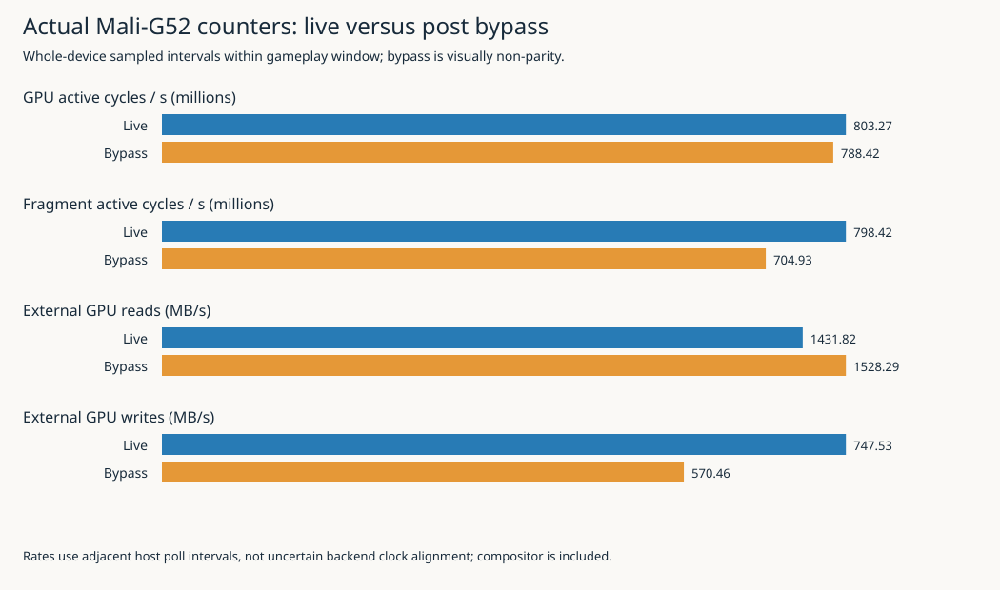
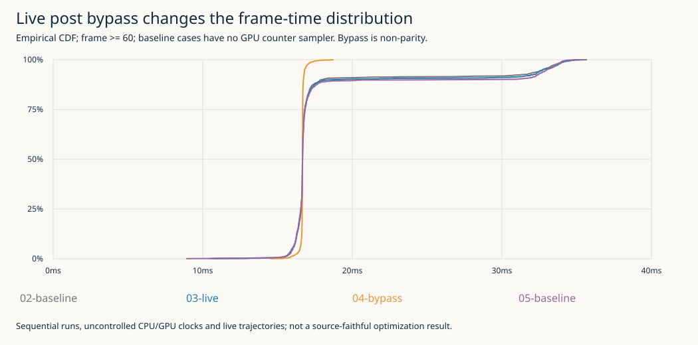

## Step 1: Identify the actual driver and build a direct hardware-counter probe

Following the completed vault publication, investigated the GPU tooling directly, without delegation. The device exposes a commercial-driver Mali-G52 through /dev/mali0. Arm's libGPUCounters provides an application-facing counter API for this family, independent of the missing ftrace scheduler instrumentation. This justifies attempting actual counter collection rather than assuming the kernel's disabled FTRACE also prohibits GPU hardware counters.

Saved primary Arm documentation under this ticket's sources folder and built a separate ARM64 probe using the existing offline toolchain. No application/runtime source, installed driver, governor, policy, system package or production launcher was changed. Counter access remains unproven at this build checkpoint.

### Prompt Context
**User prompt (verbatim):** "go ahead. commit at appropriate intervals and keep a detailed diary as you work (using the diary format from the skill)."
**Assistant interpretation:** Proceed with the already identified next step: exact Mali hardware/driver identity, counter interface access and tool compatibility, followed by useful bounded measurements where supported.
**Inferred user intent:** Obtain more precise GPU evidence without another large orchestration or preliminary-test exercise.
**Prior direction:** Work directly unless parallelism genuinely warrants delegation; preserve useful documentation in sources/; publication was completed first as requested.

### What I did
- Ran ticket-local scripts/03-mali-counters/01-inventory.sh read-only on the target; saved evidence/device-inventory.txt.
- Used Kagi queries `Arm libGPUCounters Mali G52 Linux kbase gator Streamline hardware counters profiling` and `Arm Streamline Linux Mali G52 gatord hardware counters /dev/mali0 libGPUCounters requirements`. Primary result: ARM-software/libGPUCounters; supporting Arm gator README and G52 counter reference.
- scripts02-fetch.sh cloned a pinned shallow libGPUCounters checkout into ignored .work, copied README and G52 reference bytes, extracted Arm GitHub pages with Defuddle, recorded URLs/revision/fetchUTC/SHA256 in sources/. Third-party implementation and binaries remain ignored.
- Read API example, counter configuration/sampling implementation and derived counter formulas. Implemented probe.cpp using the public library API: explicit sampling start/stop, up to120s,10Hz, monotonic host request/completion timestamps and backend sample timestamp, named counters, unsupported/error/nonfinite reporting and final counts. Never reuse stale values after sample failure.
- Built through03-build.sh/CMake using existing offline falllinie-spike-toolchain, aarch64 GCC and no installs/network during build.

### Why
Streamline normally involves gatord and host tooling. libGPUCounters exposes public Mali hardware counters directly and is a narrower first path for our existing measured game. Its README explicitly limits support to Arm commercial drivers and targets Bifrost-era GPUs onward; this target fits that source-level compatibility statement. Actual successful ioctls/samples are still required before claiming device support.

### What worked
Inventory identifies Anbernic RG DS Plus/RK3568, Mali-G52 one core r1p0 GPU ID0x07040002, available shader mask0x1, mali_kbase r54p2-02eac0 (UK11.46), libmali.so.1.10.0 and /dev/mali0. renderdoccmd exists; gatord/malioc are not in PATH. Direct probe cross-build succeeded with build ID0704c24e352901986b05d0f38625aa3cd6d5df91; executable SHA is in evidence/probe.sha256.

### What didn't work
Two exploratory rg paths were guessed incorrectly: `backend/include/device/hwcnt` and `hwcpipe/include/hwcpipe/counter_metadata.hpp` returned `No such file or directory (os error 2)`. Correct paths are backend/device/include/device/hwcnt and hwcpipe/include/hwcpipe/types.hpp. No build failure, device counter test or driver setting change occurred in this checkpoint.

### What I learned
The kernel module and userspace library have distinct version identities; a filename containing g29p1 does not establish the running module version. RenderDoc being present proves an executable exists, not that GLES/Mali capture works. Counter formulas named Util generally normalize against GPU-active cycles, not elapsed wall time; they must not be described as whole-interval GPU utilization.

### What was tricky to build
The sampler can leave its previous buffer unchanged on failed collection, so the probe skips retrieval entirely on error. Derived ratios can become nonfinite on idle zero denominators; those remain explicit invalid ratio rows, not zeros. GPU-wide counters include compositor/other clients, unlike PID-scoped CPU perf from TRACE005. Clock-frequency snapshots cannot reconstruct time-varying frequency exactly.

### What warrants a second pair of eyes
Actual driver/interface support, counter interval/reset semantics, whole-device scope, derived metric denominators and matching the game's active interval to probe timestamps. Do not diagnose a shader from whole-device ratios without controlled workload changes.

### What should be done in the future
Run one bounded idle/live/bypass campaign with no-counter baselines once this tooling is ready. Preserve raw counters and failures before interpreting ratios. Confirm supported counters from actual device enumeration. Consider Streamline/gatord integration or shader compiler analysis only if the direct data leaves a question they can answer.

### Code review instructions
Start at scripts/03-mali-counters/probe.cpp, source receipts and device-inventory.txt. The probe has no GL calls and cannot alter game simulation. Rebuild with03-build.sh; do not commit .work or downloaded implementation. The original hardware snapshot includes historical boot warnings and does not claim they were caused by profiling.

### Technical details
Core clock source is CLOCK_MONOTONIC; backend timestamps are retained without asserting they equal the request boundary. Selected counters include GPU/core/fragment/nonfragment/tiler active cycles, external read/write bytes, activity/unit ratios and bus stalls. Success/error/unsupported states remain separate. Sampling is whole-device, not a per-frame pass measurement. No BPF, FTRACE or KPROBE attachment is involved.

## Step 2: Actual counters work; live post bypass changes the frame distribution

Ran the complete prepared capture sequence instead of repeated micro-probes. The driver database advertised240counters, all13requested metrics configured, and the idle/live/bypass captures completed with zero sampling errors. Four30-second game runs (no-counter baseline, counted live, counted bypass, closing baseline) completed with GL and audio-health checks clear.

The results add GPU-side evidence independent of the questionable GL elapsed queries. In the counted normal run mean frame interval was18.171ms/p99 34.095ms; non-parity post bypass changed this to16.666ms/p99 17.392ms. Fragment-active cycles and external writes also decreased. This makes source-preserving post-path experiments useful, but bypass is not a parity-preserving optimization or an isolated shader-time measurement.

### Prompt Context
**User prompt:** SeeStep1.
**Assistant interpretation:** Complete a substantive hardware capture and explain actual counter semantics, preserving failures and uncertainty.
**Inferred user intent:** Get real GPU evidence and actionable next experiments, with graphs and an evidence-backed diary rather than another tools list.
**Commit (probe/research):**7b22f7d — Identify Mali counter interfaces and build isolated ARM counter probe.

### What I did
- Implemented04-target-case.sh/05-campaign.sh; deployed only standalone probe, unchanged TRACE005 binary and helper to/storage/apps/falllinie-mali-20261014T024712Z. Inspected for active game/collector before starting. No existing process was stopped.
- Executed idle30s, baseline30s, live30s with45s counter capture, bypass30s with45s capture and closing baseline30s. Internal/external bounds and owned-child cleanup were explicit. All five cases returned0.
- Preserved15600raw counter rows, actual enumeration, config, application sidecars/receipts, binary hashes, status, stderr and launch logs. Graph analyzer reconciles final counts,13counter identities per sample and contiguous sequence IDs; no data loss hidden behind successful exit.
- Collected paired CLOCK_MONOTONIC timestamps for game phase boundaries. Restricted live aggregates to adjacent host counter polls fully inside frame>=60's paired extent. Central windows have283/279intervals and zero nonfinite values.
- Added06-analyze.py, summary/provenance JSON and twoSVGs; reportanalysis01 explains measured counter access/tool state, actual formulas, results and next experiments. Saved pinned sampler/timestamp/formula/G52 mapping source andMITlicense in sources/.

### Why
A working GPU counter interface can answer hardware-activity questions that CPU perf cannot. Whole-device event counts still need explicit scope, interval and denominator definitions. Post bypass is an existing actual-work omission, useful for checking a rendering hypothesis without implementing a speculative optimization first.

### What worked
All13requested metrics configured; three collectors reported errors0/stopok. Four game runs reported GL_error0, callbackover_budget0, starvation0 and missingframes0. Initial/closing no-counter means18.034/18.295ms bracket the counted normal18.171ms mean. No large broad slowdown is apparent in that sequence; no zero-overhead claim follows. Idle/core activity and full live activity distinguish actual counter access from mere device enumeration.

Live central rates:GPU-active803.27Mcycles/s,fragment798.42Mcycles/s,external reads1431.82MB/s,writes747.53MB/s. Bypass:788.42M,704.93M,1528.29MB/s,570.46MB/s. Fragment/GPU-active ratio99.40%→89.41%; per-sample arithmetic ratio70.66%→64.62%; texture13.12%→7.89%. All selected frequency snapshots800MHz; all these ratios/rates retain their documented denominators and whole-device scope.

### What didn't work
- Derived ratios produced591nonfinite rows in idle/startup/tail intervals (299idle,145live,147bypass). Probe preserves statusnonfinite and leaves value empty. No selected central live/bypass row was nonfinite. Treating idle0/0 as a measured0%would fabricate information.
- Backend sample-begin timestamps are1.262–1.268seconds ahead of hostmonotonic completion. No direct clock join or fixed-offset correction is used. Backend clock identity is not inferred solely from one helper usingMONOTONIC_RAW.
- Observed GPU-active rate803.27M/s slightly exceeds800MHz snapshots. Do not normalize/clamp it into100%utilization; interval/frequency/counter calibration remains bounded evidence, not an exact busy-time meter.
- `defuddle parse https://developer.arm.com/tools-and-software/mali-offline-compiler --md -o ...` emitted `Defuddle: Error parsing schema.org data: SyntaxError: Expected property name or '}' in JSON at position 1 (line 1 column 2)` and returned0 with a zero-byte extraction. Fetch log and empty file preserved; not described as successfully archived documentation. Official URL/search discovery alone does not qualify the compiler.
- An exploratory rg of `hwcpipe/src/hwcpipe/counter_database.cpp` found no file; the actual generated map is underdetail/counter_map/bifrost.cpp. Correct G52 formulas were inspected rather than guessed from a generic GPU.

### What I learned
G52GPUActive counts cycles with pending queues, even while stalled, rather than successful computation. Fragment/core/tiler activity can overlap. Higher read bytes/s with bypass does not refute removed post reads because frame throughput, scene trajectory and access pattern also changed. Near-zero selected external-bus stall counters are narrow observations, not proof the memory subsystem cannot constrain execution.

### What was tricky to build
Keep clock domains separate while correlating the game's active window. The high-level sampler exposes backend begin but not end in counter_sample; rates therefore use approximate host poll intervals, excluding the first poll and startup/tail. This loses precise hardware interval attribution but avoids a demonstrably wrong nanosecond join. The whole-device sampler includes the compositor; no PID-only GPU claim is made.

### What warrants a second pair of eyes
Counter-domain calibration and driver-specific semantics; pending-work versus productive cycles; activity/traffic differences under non-parity bypass and different live trajectories. No extrapolated standalone-post GPU milliseconds or promised shader speedup is justified.

### What should be done in the future
Add documented fragment/nonfragment queue dependency, descriptor-read and cache-flush wait counters for a focused follow-up. Investigate shader arithmetic with a verified Offline Compiler or specific instruction counters before making source-preserving changes. Streamline may offer richer timelines, but its full target setup remains unqualified and is not necessary merely to repeat this successful counter capture.

### Code review instructions
Readanalysis/01-mali-g52-counter-access-and-measured-post-processing-experiment.md,06-analyze.py andsources/mali-g52-counter-reference.html. Reproduce JSON/figures with06-analyze.py; inspect original counters.log/counters.csv alongside final counts. Actual normal/bypass comparisons are not frozen-scene replays or randomized repetitions. No application source test matrix is repeated because game binary/source are unchanged.

### Technical details
Game runtime209a6d0, unchanged binary2872ede7219ccd91890de4c0d47d5af8fab687f2b5b2cf9605e25ecb1dfcb1d2. Library378c7b59e2dae87cbbffb0ac9cf96ed13c939823. Whole-device capture,10Hz,13metrics, threeboundedcollections. GPU elapsed queriesoff; pairedCPUcadence60. No installs, policy/driver/governor changes or further delegation.

### Visual evidence

Input SHA256s and aggregation boundaries are inevidence/analysis-provenance.json. The figures are generated from retained actual samples; no synthetic performance series is used.
