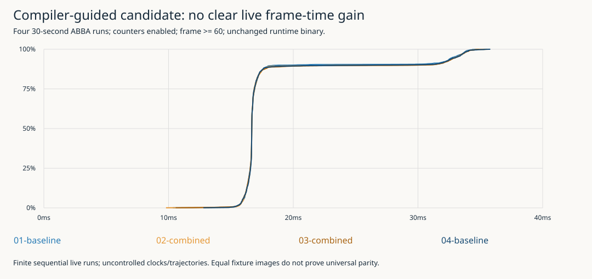

## Step 1: Compile actual adapted shader bytes and compare focused candidates

Continued directly from the real GPU-counter campaign. Downloaded Arm's current official Performance Studio archive into ignored local storage, verified its publishedSHA256 and extracted only the offline compiler subtree without installing system packages. The actual compiler now supplies instruction/register evidence, rather than merely being a suggested tool.

Added an optional developer shader-dump environment variable at the exact glShaderSource boundary. A single host fixture frame obtains the default adapted shader inputs; this is input acquisition, not a performance test. Compiler reports reveal that two individually plausible changes interact strongly through register allocation, which determines the candidate worth trying on hardware.

### Prompt Context
**User prompt (verbatim, JSON-escaped to preserve the line break/trailing space):** "commit at appropriate intervals and keep a detailed diary as you work (using the diary format from the skill). \n\nThen continue, don't spent time overcautiously testing / preemptively testing, we are debugging / developing right now anyway, no need to test for the test."
**Assistant interpretation:** Use the offline compiler concretely, choose a focused source-preserving candidate, then judge it with actual device measurements rather than repeated preliminary checks.
**Inferred user intent:** Make useful optimization progress and preserve the reasoning/results in commits and diary.

### What I did
- Kagi located Arm's compiler learning path and official product/download pages. Defuddle saved the useful learning path in sources/malioc-learning-path.txt. Browser inspection recovered the actual download link after the previous product-page extraction was empty.
- Downloaded official Arm Performance Studio2026.5 Linuxx86-64 archive via01-fetch-compiler.sh. SHA256f9a776cdabdeb56a228c1d2f153eac6067a38a55d7330d6ac8de84824bcd6c3f matched Arm's response header. Archive/binaries remain in ignored.work; only receipts/reports/scripts are tracked.
- Added FALLLINIE_SHADER_DUMP_DIR in Renderer compile(): when explicitly set, write exact source bytes before glShaderSource. Disabled by default; no per-frame work and no source rewriting. Dump failures fail the requested diagnostic explicitly.
- Built existing host target once and ran one frozen fixture frame to collect8actualshader inputs, including highp depth sampler, wrapped stable sky and relative projection adaptations.
- Compiled every input for Mali-G52;03-variants.py builds baseline, lazy-color, fog-skip and combined diagnostic assets/reports. Canonical assets/shaders are unchanged.

### Why
Analyzing the asset file alone would miss runtime adaptations, particularly the170-entry sky uniform array. Identical GLSLbytes do not mean identical driver compiler: this offline compiler's G52 backend is r51p0, while the target kernel is r54p2 and userspace has its own identity. Static reports rank hypotheses, not actual frame savings.

### What worked
Mali Offline Compiler2026.5.0 build922df8 executed, targeting G52r1p0/Bifrost/OpenGLES with r51p0-00rel0 compiler. Baseline post reports32workregisters/100%occupancy,126uniformregisters,no stack,0%16bitarithmetic; total A/LS/V/T10.63/8/0/3.5 and arithmetic bound. Scene fragment is also estimated arithmetic bound. No broad CPU/audio test matrix was run merely for the tooling.

### What didn't work
The attempted search for a standalone compiler tarball returned no results. Arm currently distributes it within the larger763MiB Performance Studio archive; extracted only the compiler locally. No failed build or shader compilation occurred.

Individual candidate expectations were contradicted by compiler output: lazy-color alone increases total A10.75/T5.0; fog-skip alone uses60registers/50%occupancy. Combined uses32registers/100%occupancy, total A10.80/LS8/T3.0, with shorter fogged path A2.70/T1.0. These are compiled estimates, not claims of improvement.

### What I learned
Moving a source-level sample inside a branch need not make compiled work cheaper. Register allocation and scheduling couple local transformations, so checking a complete candidate matters more than counting source expressions.

### What was tricky to build
Fog skip computes the same center linear depth, then only bypasses the neighborhood when zc>=uFogP.y. In the baseline that region multiplies the edge by zero. All original edge expressions remain in the contributing path; black=max(black,edge) remains outside. Lazy color avoids the center color sample on sky pixels where that value is unused. Sampling is nearest/clamp without mipmaps; no claim about arbitrary sampler settings or invalid depth/uniform inputs is made.

### What warrants a second pair of eyes
Compiler changes can alter floating-point scheduling even when formulas are retained. A bounded same-device image comparison and live measurements are needed; static register/cycle estimates alone cannot accept this shader. The sky's8load/storecycles and arithmetic-heavy paths do not establish measured per-pass GPU times.

### What should be done in the future
Run baseline/combined ABBA live comparisons with counters and a matching frozen fixture image pair. Keep the combined asset diagnostic-only until evidence supports adoption; reject it if it regresses or alters required appearance. Do not mix uniform-location caching or other renderer changes into this comparison.

### Code review instructions
Inspect src/renderer.cpp optional dump and scripts/04-shader-analysis/{02-compile-runtime.sh,03-variants.py}. Compare inputs/runtime/3.frag to generatedbaseline.frag (identical), and inputs/assets/combined/post_fs.glsl to canonicalpost_fs. Raw text/JSON compiler output and source hashes are inevidence/. No new remote compiler/library is installed on the handheld.

### Technical details
Baseline compiler longest path A9.13/LS8/T0.5; combined A9.17/LS8/T0.5. Shortest A3.53/T3.5 versus A2.70/T1.0. Longest/shortest paths are compiler paths, not measured image coverage. Fog endpoint is existing380m; precision, formulas, sky hash sequence and source constants remain unchanged. Diagnostic assets live under the ticket, not canonical game assets.

## Step 2: Finish the ABBA experiment and reject promotion of the candidate

The complete four-run baseline/combined/combined/baseline experiment did not produce a convincing speedup. The pooled postwarmup baseline mean is18.262742ms and candidate18.317052ms, a descriptive difference of+0.054310ms (about0.30%) in the slower direction. Sequential live runs and uncontrolled clocks do not justify treating that tiny difference as a proven regression, but they certainly do not justify promoting it as an optimization.

The same-device fixed seven-cell terrain fixture produced byte-identical scene, depth and final print BMPs between baseline and candidate. That is a useful bounded image result, not universal gameplay parity. The canonical shader remains unchanged; diagnostic assets and all results are retained for the requested detailed report.

### Prompt Context
**User prompt:** SeeStep1.
**User prompt (verbatim):** "keep detailed notes sa you work so we can create solid report. (and use your diary)"
**User prompt (verbatim):** "and then when done, stop for the night"
**User request (subsequent):** Write a detailed textbook-style deep-dive project report in the Obsidian vault, commit/push it, then stop. Publication is the final action sequence; no further experiments are planned tonight.
**Assistant interpretation:** Finish current evidence, record the rejected optimization honestly, publish the requested technical narrative and stop.
**Inferred user intent:** Preserve learning and concrete data without extending the debugging session indefinitely.
**Commit (compiler/tooling):**837bb32 — Analyze exact G52 shader inputs and prepare compiler-guided post variants.

### What I did
- Added an ASSETS override to the bounded counter case runner, preserving its original default; deployed only separate baseline/combined asset folders, unchanged209a6d0game and the qualified counterprobe.
- Obtained matching static seven-cell/seed42/384×288 captures to include farther terrain. Compared exactBMP SHA256 and decoded RGB bytes. Scene/depth/print all identical; printSHA256360a0b856157478e030a43a8c8c264bdb2300273c471c3efe0799c6635d809e8, zero changedpixels.
- Executed four30-second live cases, each with45-second standalone counter collection. Cases returned0. No production launcher or canonical shader changed.
- Added05-analyze.py to reconcile paired final counts,450counter sequences×13metrics per run, actual frame distributions, matched central counter windows and image hashes. Generated actual ABBA-CDF and compiler-comparison SVGs, exact summaries and provenance.

### Why
The combined candidate avoids the compiler-estimated register occupancy loss of fog-skip alone, but only a full workload can decide whether the changed path matters on this game. The successful image fixture establishes a limited correctness observation; it cannot replace timing data or imply broader appearance proof.

### What worked
Four game runs: GL_error0, callbackover_budget0,starvation0,missingframes0. Fourcountercaptures:23400rows,zero sampling errors,successfulstop; all central selected rows finite. Counter windows283/285/285/285intervals. Paired records complete with zero invalid/dropped samples. Fixture images byte-identical.

Postwarmup frame means/p95/p99 inms:
- Baseline01:18.217710/32.837417/33.893343,1581frames.
- Combined02:18.306310/33.054196/34.086162,1576frames.
- Combined03:18.327795/33.111946/34.087039,1576frames.
- Baseline04:18.307947/33.077488/34.046289,1575frames.

Hardware activity likewise remains similar: GPU-active rates805.55/804.11/803.66/803.25Mcycles/s and fragment rates801.04/799.29/798.65/798.50Mcycles/s. These approximate host-window rates still have the clock/frequency qualifications of diary04, not calibrated GPU utilization.

### What didn't work
- First deployment omitted the shared parent-directory font/number atlases. Renderer initialization failed before the fixed capture with `fatal: missing source HUD font atlas`. Shader programs had linked successfully. Preserved failure log at evidence/target-20261014T031958Z/capture-baseline.log. Added originalhud-font.bmp/glyphs.bmp to the private package and ran the full campaign once; no partial measurement matrix was repeated.
- The candidate did not improve frame distributions relative to baseline. This is the result, not a reason to discard the experiment or keep tweaking until a favorable run appears.
- Exploratory Pillow image comparison emitted a getdata deprecation warning for a future release. Byte hashes and decoded pixels agreed; final reproducible analyzer uses raw byte equality and does not depend on that deprecated call.

### What I learned
The compiler avoided one bad candidate choice but could not predict a runtime win. Cheaper shortest-path estimates matter only if that path has sufficient coverage and impact; we have not instrumented coverage. Similar measured rates and frame tails leave the broader post workload as a target, not this local rewrite as a successful fix.

### What was tricky to build
The shader directory is not a self-contained runtime asset package: renderer also resolves ../hud-font.bmp and ../glyphs.bmp. Keep package structure explicit rather than interpreting initialization failure as shader incompatibility. The program binary remained identical across all measured cases; only postassetselection changed.

### What warrants a second pair of eyes
No causal claim that fog coverage was low, no proven0.30%regression, no universal parity claim. Compare baseline drift with the candidate values before making a decision. Static compiler backendr51p0 is not claimed to match installed userspace codegen.

### What should be done in the future
Do not promote this candidate. Future sessions may investigate actual path coverage, queue-wait counters or shader work with stronger evidence. Tonight: publish the report and stop, as explicitly requested.

### Code review instructions
Read evidence/experiment-summary.json/.txt and raw evidence/target-20261014T032113Z, compare inputs/assets/combined/post_fs.glsl against canonical assets/shaders/post_fs.glsl, and inspect05-analyze.py. The prior non-parity bypass campaign is a different experiment; do not substitute its speedup for this candidate's null result.

### Technical details
6308postwarmup frames in thisABBAcomparison;3156baseline/3152candidate. All four45s sampler runs have450sequences,13metrics,5850rows. Image equality is for the explicit staticfixture only. No new hardware run is required for publication.

### Visual evidence

Raw cases, compiler versions/inputs and decision are preserved so the report can explain both useful findings and the rejected optimization.
