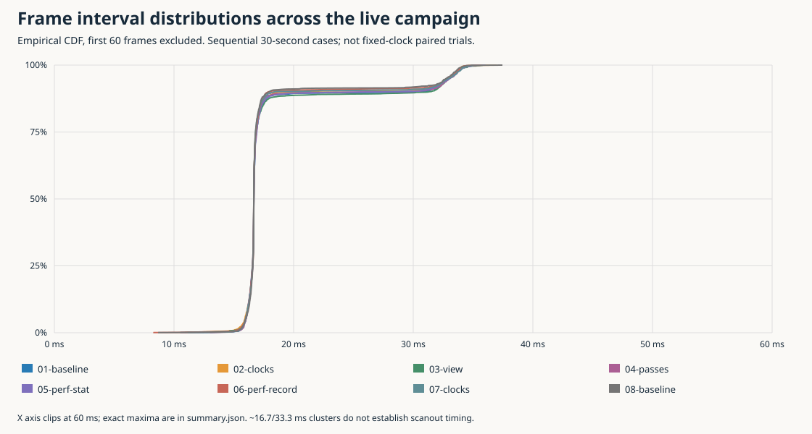
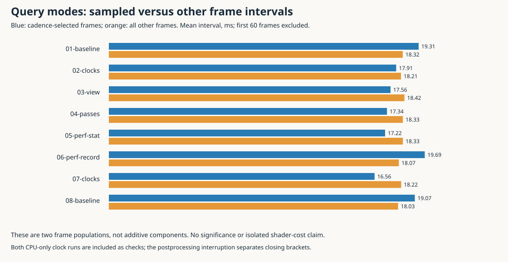
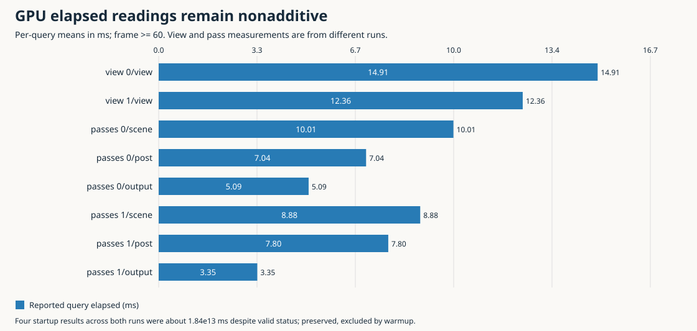

# What we can now measure

A drawing call's wall duration is not the time the application thread spent executing instructions. The thread can run application and driver code, block inside the driver or window system, or be runnable without receiving a CPU. The new optional `--paired-clocks` sidecar records both monotonic wall timestamps and that thread's CPU timestamps around the same scope. For each valid pair:

```text
wall_ms = (wall_end_ns - wall_start_ns) / 1e6
cpu_ms  = (cpu_end_ns  - cpu_start_ns)  / 1e6
nonrunning_estimate_ms = wall_ms - cpu_ms
```

The residual combines non-running time and clock-read/accounting error. It is **not a GPU-wait measurement**. Sampling the executing thread with perf answers a different question: which code was executing when samples were taken? Combining those observations is useful without pretending they identify every wait reason.

This is the implementation-and-measurement follow-up to the earlier tracing design. It reports actual target runs, not the synthetic scheduler example in the published research article. The original vault article remains unchanged.

# Implementation and experiment

Runtime commit `209a6d0` integrates the independently reviewed worker implementation. Profiling is explicitly enabled with `--paired-clocks --profile PATH`; both disabled and unsampled paths skip the new clock reads. Samples carry frame, view, stage/pass, PID/TID and monotonic run identity. A fixed64-record buffer is flushed outside active paired scopes. Final counters expose invalid readings, known drops and incomplete transport. The analyzer pairs timestamps within a row, never subtracting unrelated group averages.

The new frame boundaries cover events, physics, player updates including streaming, context changes, swaps and pacing. Existing nested render view/scene/post/output/dynamic scopes retain their meanings. They are **not additive across parent and child scopes**. Some frame operations remain outside these scopes; this is useful debugging coverage, not a complete frame partition.

One host feature-boundary gate passed15/15tests; a focused read-only review found no issues. The ARM binary used existing target libraries, `-O2 -g -fno-omit-frame-pointer`, and SHA256:

```text
2872ede7219ccd91890de4c0d47d5af8fab687f2b5b2cf9605e25ecb1dfcb1d2
```

Eight30-second live autoplay cases ran on the RG DS Plus. Each used dual384×288 internal rendering, fps60 cap, no-vsync, seed42, overlay, buffered1024 audio and source vinyl. Audio was muted at output but still computed. The production launcher/binary were untouched. The cadence was60; frame/clock analyses below exclude the first60frames of each run. The sample is13133totalframes,12653postwarmup frames and3360valid paired records, with no dropped or invalid paired records.

The governor remained ondemand; clocks and scene progression were not fixed. Cases are sequential, not randomized replicates. Closing cases were separated from the initial sequence by perf-report recovery. These facts limit observer-effect and performance comparisons.

# Rendering contains both CPU execution and non-running time


The first clock-only run, with GPU queries off, has27postwarmup samples per scope:

| Scope | Mean wall ms | Mean thread CPU ms | Mean non-running estimate ms |
|---|---:|---:|---:|
| Top view |7.645|4.522|3.122|
| Lower view |7.031|2.774|4.257|
| Top scene |2.881|2.596|0.286|
| Top post |0.660|0.584|0.076|
| Top output |4.069|1.293|2.776|

Top scene/post/output are nested within top view: do not add all four rows. The output scope accounts for most of the top view's measured residual in this sample. The closing clock run has top view7.582ms wall/4.180ms CPU and lower view5.986/2.513ms. It confirms the presence of substantial non-running time, not an identical quantitative distribution.

This resolves an important ambiguity in the previous wall-only profiles. Optimizing application arithmetic cannot be assumed to recover the whole7–8ms top-view duration. Conversely, the scope is not merely idle waiting: several milliseconds are real executing CPU work.

# perf identifies substantial driver execution


`perf record` collected3973cpu-clock samples at a requested99Hz, with0reported lost samples. Collection included the application and inherited threads, not all system processes. The recording used the mono clock; IDs and build IDs are retained. The flat report includes startup, unlike the warmup-filtered clock figures.

The main thread's total share is39.28% of sampled CPU periods across all collected threads. Its execution inside `libmali.so.1.10.0` accounts for28.06% of that overall sample population: approximately71.44% of the main thread's sampled execution. This is **CPU driver work**, not Mali GPU utilization and not71% of frame wall time. The library lacks useful function names at many sampled addresses, so the supported attribution is to the driver object, not a named internal algorithm.

The audio producer is also a substantial CPU consumer. Its application-object share is37.10% of the overall sample population; leading symbols include planar convolution accumulation and voice sampling. This corroborates the earlier audio work without suggesting DSP moved back into the callback. All eight runs reported0starved callbacks,0missing frames and0callback budget overruns; these are finite application observations, not backend XRUN or physical-latency measurements.

The separate perf-stat run counted39610.22ms of aggregate process/thread CPU time,83050context switches and18127CPU migrations. These counts cover the entire launched workload, including startup. They neither reconstruct scheduling history nor distinguish blocking from runnable delay. Busy driver/audio threads make a process CPU total greater than elapsed wall time unsurprising.

# Frame distributions and observer effects



| Case | Mean ms | p95 ms | p99 ms |
|---|---:|---:|---:|
|01 baseline|18.335|33.060|34.194|
|02 paired clocks|18.202|32.949|33.942|
|03 whole-view queries|18.408|33.034|34.255|
|04 per-pass queries|18.309|33.026|34.166|
|05 perf stat|18.309|33.030|34.154|
|06 perf record|18.102|32.861|34.029|
|07 paired clocks|18.191|32.976|34.190|
|08 baseline|18.047|32.755|33.882|

All cases completed withGL_error0. The16.7ms and33.3ms interval concentrations are visible, but frame-loop timing is not measured scanout. These runs do not establish robust60FPS; their means exceed16.667ms and their upper tails are roughly twice that budget.



Cadence-selected frames in the view/pass runs were not markedly slower than other frames in this campaign. That is useful negative evidence against a simple claim that query frames alone are dramatically inflated. It is **not proof of zero observer effect**: only27postwarmup selected frames were observed per run, GPU work may complete later, scenes differed with timing, and device clocks were uncontrolled. No precise overhead bound or significance claim follows from the small spread of whole-run means.

# GPU elapsed results are still not an additive budget



After warmup, whole-view means are14.908ms top and12.363ms lower, summing to27.272ms. Per-pass means from the separate pass-query run are:

| View | Scene ms | Post ms | Output ms |
|---|---:|---:|---:|
|Top|10.010|7.044|5.092|
|Lower|8.883|7.797|3.348|

Those six means sum to42.174ms against an18.309ms mean frame interval in that run. Changing the query granularity therefore does not make the results a trustworthy sum of independent pass costs. Subtracting query totals to estimate savings from a shader optimization would be unjustified.

There is an additional concrete validity problem: four startup query results across the two GPU-query runs were approximately1.84467441×10¹³ms while the API-derived status said`valid`. That is physically impossible for this30-second experiment. The raw records are preserved; the shared frame<60warmup exclusion removes them from the displayed means, not from the evidence. Later finite values do not acquire causal validity merely because they fit in a plausible numeric range. The unsigned-looking magnitude is a debugging clue, not a proven explanation of the driver behavior.

The observed limits are specific: paired CPU clocks are interpretable; perf identifies executing objects; this GPU elapsed path still needs driver/query interpretation before it can rank individual passes by cost. No busy counter or utilization measure was collected.

# Why scheduler and eBPF tracing did not proceed

The actual image provides perf7.2.7 andCONFIG_PERF_EVENTS. BPF/BPF_SYSCALL/BPF_JIT are enabled, butFTRACE andKPROBES are explicitly disabled. KernelBTF and the usual bpftrace/bpftool/trace-cmd tools are absent, and the inventory found no readable trace root. BPF configuration alone is not evidence that the required scheduler/driver hooks are available.

We used the supported clocks and perf facilities rather than installing packages, weakening policy or replacing the kernel. Consequently, the residual remains an unresolved combination of blocked time and runnable delay. No exact ioctl/fence duration or causal GPU-wait claim is made. This is a recorded capability limit, not a failed implementation of a mechanism the image supports.

# What to try next

The strongest CPU evidence supports experiments that reduce main-thread driver work: fewer redundant state/uniform operations, fewer unnecessary submissions and carefully bounded reuse of camera-independent data. These are hypotheses to test against the same whole workload; a sampled driver address does not prove any particular call is redundant.

The output scope's large residual makes output-path/backpressure investigation valuable, but it does not yet justify changing compositor, synchronization or scheduling policy. Keep any visual/source behavior changes explicit. Preserve the single simulation/audio authority and main-thread GL ownership rather than adding rendering threads as a presumed remedy.

For GPU-side ranking, first explain the impossible startup values and nonadditive elapsed semantics. For exact offCPU attribution, a supported scheduler/driver tracing path would be needed. Neither gap prevents practical end-to-end comparisons of a concrete optimization, provided the result is described as a workload change rather than a fictional isolated GPU cost.

# Reproduction and diary

- [Detailed diary, implementation and actual failures](../reference/01-tracing-investigation-and-publication-diary.md)
- [Worker clock/schema usage](../scripts/paired-clocks/00-usage.md)
- [Exact campaign summary](../scripts/evidence/campaign-summary.json)
- [Figure/input SHA256 provenance](../scripts/figures/provenance.json)
- [Graph generator](../scripts/09-graphs.py)

Run`python3 scripts/09-graphs.py` from this ticket's directory to regenerate all five figures and aggregates. The generator validates each paired sidecar before calculating its graphs. The original SSH authentication failure and perf addr2line/SIGPIPE failure are retained in the diary and logs; neither is hidden as an application failure. Raw perf stays in ignored local storage. All durable source, bounded receipts, graphs and analysis are committed intentionally; no native code or new vault report is pushed as part of this measurement step.
