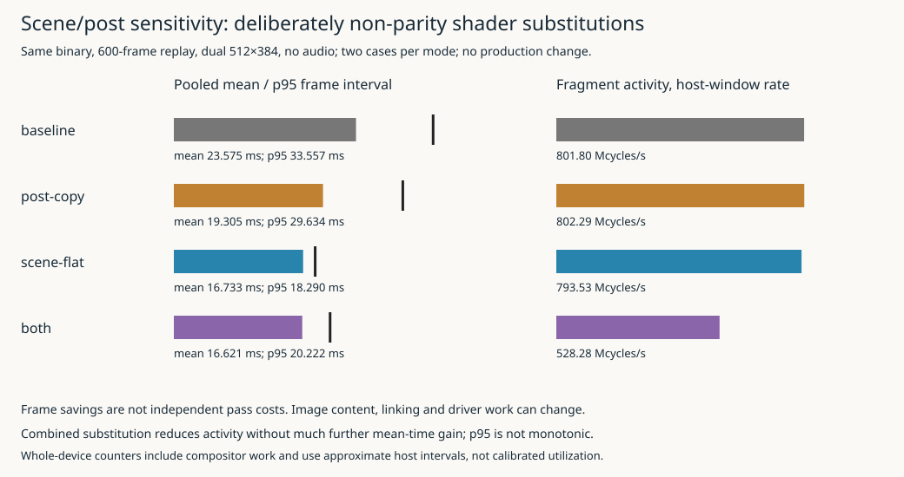

# Actual scene and post sensitivity

## Outcome

The symmetric eight-case campaign completed successfully on the handheld. Replacing the print shader with a depth-aware grayscale copy reduced pooled mean frame interval from **23.5751 to19.3049ms**. Flattening scene shading while retaining original post-processing reduced it to **16.7327ms**. Combining both reached **16.6207ms**, with substantially lower hardware activity but little further mean-time improvement.

These are **deliberately non-parity work/content substitutions**, not source-faithful optimizations. They support prioritizing narrower scene-shader investigation rather than assuming the post pass alone explains the remaining cost. They do not identify independent pass durations or prove which original instruction is expensive. Canonical shaders, runtime source, production settings and launcher remain unchanged.

## Controls and substitutions

All cases use the unchanged GPU006 binary (runtime32b8bfd, SHA256`90f124a7745a37f76175130bd79ef748b741852bccfe58305548f7946c0d82ed`), seed42,600fixed-input frames,32terrain work units/frame, dual512×384, no application pacing, no audio, ordinary indexed draws and query-off paired clocks at cadence60. Each case has a45second hardware-counter capture. No governor, driver, physical output or compositor-policy change was made.

The original scene shader computes lighting, analytic rider shadows, contour/grid markings, glyphs and fog. The scene-flat diagnostic keeps geometry, vertex-position source, material encoding and snow-circle discard, but returns constant luminance without those calculations. The original source body remains unreachable after the diagnostic return so the existing source-adaptation anchors are preserved.

Cheap post retains the print FBO and fullscreen draw. It reads center depth, outputs white for sky, otherwise copies scene luminance to grayscale. It omits the original neighborhood, sky, print-style and related processing. This is not the old post-bypass option: that option removes the post draw, whereas this experiment keeps a cheap draw. Existing --assets selection chooses each package; replay's post-bypass restriction remains intact.

The first host attempt used color alone. It linked, but the renderer rejected the optimized-away required sampler with `fatal: missing print uniform uD`. Meaningful depth selection fixed the contract without weakening production checks. Failed logs/submitted shaders remain under evidence/host-first-attempt. Four corrected60-frame host cases passed linking, signature and image relationship checks before target collection.

The target asset manifest contains18files, including original parent-directory HUD/glyph atlases. Every asset was checksum-verified on the device before and after the matrix. Each case records its exact arguments and explicit diagnostic/non-parity classification. The executable hash was independently checked; the old application's source receipt alone is not used as evidence of which external shader package ran.

## Actual runs and grouped distributions

The sequence was baseline, post-copy, scene-flat, both, both, scene-flat, post-copy, baseline. Frame summaries use frames60–599,540intervals per case. Percentiles are linearly interpolated from the recorded values. Grouped percentiles are computed from each mode's pooled1,080intervals, not averages of case percentiles.

| Case | Mean ms | p95 ms | Fragment Mcycles/s |
|---|---:|---:|---:|
|01 baseline|23.5443|33.5388|802.07|
|02 post-copy|19.3106|29.5951|802.43|
|03 scene-flat|16.7326|17.8274|792.61|
|04 both|16.6194|20.3259|529.00|
|05 both|16.6220|19.9470|527.57|
|06 scene-flat|16.7327|18.6648|794.45|
|07 post-copy|19.2991|29.6618|802.14|
|08 baseline|23.6059|33.5880|801.54|

| Mode | Pooled mean ms | p95 ms | p99 ms | Descriptive mean reduction |
|---|---:|---:|---:|---:|
|Baseline|23.575117|33.557236|34.160322|—|
|Cheap post|19.304850|29.634163|30.796855|18.11%|
|Flat scene|16.732658|18.289938|23.441278|29.02%|
|Both|16.620701|20.222285|21.951732|29.50%|

The two nonbaseline repetitions agree closely in mean. The closing baseline is only about0.26%slower than the opening baseline, much smaller than either single-factor change. This supports a reproducible sensitivity result for this finite trajectory, not a statistical confidence interval over many sessions, seeds or thermal regimes.

The results are not additive. Cheap post changes the mean by4.2703ms and flat scene by6.8425ms, but their combination changes it by6.9544ms—not their11.1127ms sum. Shared dependencies, changed downstream content and the near60/s presentation constraint prevent interpreting those deltas as separate GPU pass costs.

Nor are tails monotonically better as more work is removed. The combined p95 is20.2223ms, worse than flat scene's18.2899ms, although combined p99 is lower. The distributions cross. No exact scheduling explanation was captured, and claiming uniformly improved deadline behavior would hide this observation.

## What hardware activity adds

Baseline and cheap-post fragment-active rates are both near802Mcycles/s even though cheap post completes frames faster. Rate per second is not cost per frame. The application can finish more changed-workload frames while device activity remains high. The raw byte rates also change: post-copy reads are approximately1418–1423MB/s versus baseline1154–1158MB/s, while writes fall to about555MB/s from650–652MB/s. Faster throughput and changed image contents preclude a simplistic per-frame or bandwidth-bottleneck inference.

Flat-scene fragment activity remains about793–794Mcycles/s at16.73msmean. With both substitutions, it falls to about528Mcycles/s while mean improves by only0.1120ms. GPU-active rates fall from about803Mcycles/s for flat scene to about664–671Mcycles/s for both. This is consistent with substantial work reduction being hidden by an output/presentation constraint. It is not calibrated GPU utilization and does not prove the compositor's exact synchronization mechanism.

CPU work is not perfectly fixed by keeping the executable unchanged. Mean sums of the selected top/lower view CPU scopes are approximately6.286ms baseline,6.214ms post-copy,5.790ms scene-flat and5.282ms both. Changing linked shaders can remove active uniforms/varyings and alter driver work; the measurements do not isolate those mechanisms. These are18selected scopes per view/mode, not whole-loop CPU time, and nested child scopes are not added again.

## Repeatability, images and measurement health

All eight cases have the GPU006 signature **6081555844518115723**. Repeated scene/depth/print images match within each mode. All depth diagnostic images match across modes; baseline/post-copy scene images match, and scene-flat/both scene images match. Every diagnostic's finalprint differs from baseline as intended.

These are internal render-target captures from the uninstrumented final top-camera redraw. They exclude final full-size HUD/compositor output. Equality of the depth diagnostic does not prove every24-bit depth sample in every measured frame is identical; the state signature likewise covers selected fields, not the complete game or GPU command stream.

All8game/probe statuses arezero; all receipts report GL_error0 and successfulplacement. There are4,800frames,4,320postwarmup intervals,1,600pairedrecords and46,800counterrows. Paired attempted/written counts reconcile with zeroactive/dropped/invalid records. Counter errors and nonfinite values arezero.728contained adjacent host-poll intervals contribute to the rate calculations.

Backend-minus-host offsets span about1.724–1.735seconds in this campaign. No direct clock join or fitted offset is used. Counter rates remain whole-device, compositor-inclusive and based on approximate host intervals narrower than the complete postwarmup framewindow. GPUfrequency snapshots are800MHz; observed temperature snapshots are51.25–53.75°C and CPU snapshots vary. After snapshots occur after the probe finishes, not exactly at game exit. None proves fixed clock or thermal behavior throughout the run.

## Decision and next bounded question

Keep all three substitutions diagnostic-only. This experiment establishes substantial sensitivity to scene-related work/content and a smaller but real sensitivity to post simplification in the demanding configuration. It does not accept a visually different game as an optimization or demonstrate robust integrated60FPS with audio.

The strongest next candidate for a narrower experiment is the original scene shader's analytic rider-shadow work: three segment-distance evaluations on terrain/trails. A diagnostic shadow-only omission would separate that work from contours/glyphs/lighting more narrowly than a flat scene. It remains proposed, not measured. Other possibilities include separate marking/glyph diagnostics or presentation-path investigation. Any source-faithful rewrite must subsequently preserve the actual formulas/precision or establish an explicitly accepted fidelity change, and earn its own image and target evidence.

## Reproduction and review

Implementation/tooling checkpoint: **074588b**. Campaign: `scripts/evidence/target-20261014T191037Z`. Run05-analyze.py on that directory and06-figures.py to regenerate the results. The complete manifest, before/after remote checks, exact argv, binary hash, raw counters/frames, endpointBMPs and source/submittedshader files are retained. Production canonical sources have no diff. Detailed failures and decisions are in reference/01.
