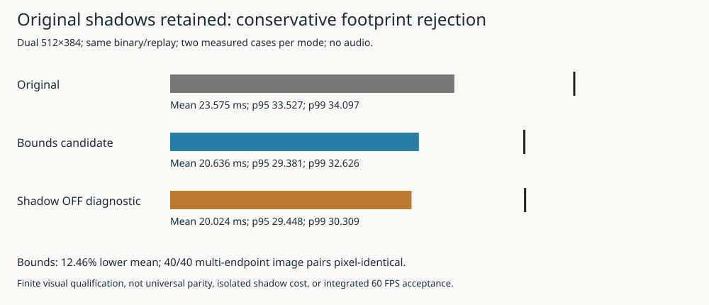
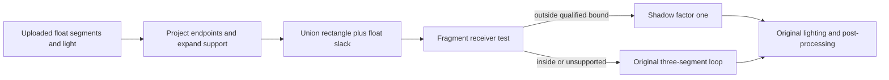
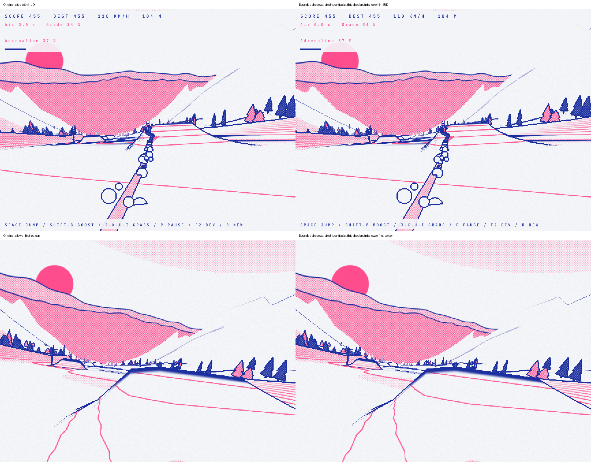
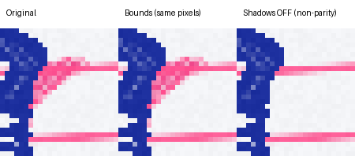

# Conservative shadow footprint: actual cost reduction without observed image loss

## Result and decision

The bounded-shadow candidate reduced pooled mean frame interval from **23.574617 to20.636466ms**, a **12.46% reduction**, on the demanding512×384 dual-view replay. Original/bounds images are pixel-identical in **40 separate image comparisons across five visual checkpoints**, including both full-window views and both views' scene/print/depth diagnostics. Measured-case endpoint images also match and repeats are stable.

This is the first measured scene candidate in this sequence that preserves the tested images instead of replacing them with flatter graphics. It remains **opt-in**, not a new production default. Approximately48.46loop frames/s is not integrated60FPS, and audio was disabled. Forty endpoint comparisons do not prove every intermediate frame, seed, receiver coordinate or device.



## Why this bound avoids changing the original shadow

The source shader evaluates the minimum of three analytic segment-shadow factors for terrain and trails. Each `rayseg` clamps its segment parameter, selects a point Q on A..B, projects onto the forward light ray from receiver P and returns a distance. Smoothstep reaches one at radius r=1.2*A.w. Outside that radius the segment cannot darken the receiver.

A circle around the rider on a flat ground plane would be unsafe on slopes. Instead, compute a light-invariant two-dimensional coordinate:

```text
F(P) = (P.x - (L.x/L.y)*P.y,
        P.z - (L.z/L.y)*P.y)
F(P + t*L) = F(P)
```

Because Q is between the segment endpoints and F is linear, F(Q) lies between their projections. The projection's component norms bound the effect of a distance r: expand X by r*sqrt(1+(L.x/L.y)^2) and Z by r*sqrt(1+(L.z/L.y)^2). Union the three expanded rectangles. A receiver outside this union cannot lie within any segment's contributing radius in exact arithmetic. Including the entire light line, rather than just its forward half, makes the bound looser but safe with respect to the source forward clamp.

The CPU computes this rectangle from the actual float endpoints sent to GL, not independently rounded double rig coordinates. It uploads the rectangle and light slope once per view. The shader projects the receiver and either retains shadow factor one or executes the **verbatim original loop**. Original lighting, contours, glyphs, fog, post-processing, precision qualifiers, geometry, ordering and material channels remain in place.



The implementation is `src/shadow_bounds.hpp`, renderer uniform uploads and explicit source adaptation. `--shadow-mode original` is the default. `off` removes only shadows and is a replay-only non-parity diagnostic. `bounds` enables the experimental guard. Canonical assets have no changes; the exact submitted shaders are retained with the visual runs.

## Floating-point limits are explicit

The geometric argument is not a universal GPU floating-point proof. The candidate qualifies finite segment and receiver components within +/-8192, normalized light, slope components no larger than2, positive radii and nondegenerate segments. It rounds rectangle endpoints outward and adds a deliberately generous **0.25 projected-world-unit slack**. Unsupported uniform inputs or receivers run the original loop rather than dropping shadows. Static-spike sentinel segments near1,000,000 therefore fall back.

The CPU stress test exercises600,000 points with translated, tilted segments and source-like float distance calculations. It rejects300,280 points while retaining all207,121 shadow-contributing samples; no false rejection was observed. All16 CPU tests and host/ARM builds passed. These tests are empirical qualification, not formal proof of all possible float operations or compiler behavior. Hardware screenshots are an independent acceptance gate.

## Repeated handheld measurements

All cases use the same new binary, canonical assets, seed42,600fixed-input frames,32terrain work units/frame,dual512×384,ordinary indexed draws,no audio,no application pacing,GPU queries off and paired clocks at cadence60. The order is original/off/bounds/bounds/off/original. Frame statistics pool frames60–599 from each case,1,080intervals per mode. Percentiles are computed from pooled values, not averaged percentiles.

| Mode | Mean ms | p95 ms | p99 ms | Mean loop/s |
|---|---:|---:|---:|---:|
| Original |23.574617|33.527307|34.097130|42.42|
| Bounds |20.636466|29.381448|32.626048|48.46|
| Shadows off, non-parity |20.024081|29.447599|30.308836|49.94|

Individual means in order are23.5747,20.0352,20.6217,20.6512,20.0130,23.5746ms. The original bracket is virtually unchanged. Both bounds repetitions improve substantially, rather than relying on a favorable closing baseline.

The original-to-off mean difference is3.5505ms. Bounds recovers2.9382ms of that difference, roughly83%, while remaining0.6124ms slower than omission. This is a descriptive comparison of loop intervals, **not the percentage of GPU shadow instructions eliminated** or an isolated shadow-pass duration. The off variant changes active uniforms and shader compilation as well as image content.

The candidate p95 improves, but p99 remains32.626ms. We have not solved60Hz deadlines. Its p95 is slightly lower than off while its p99 is higher; do not turn mean ordering into a universal tail-latency ranking.

### Counters and CPU clocks

| Mode | Fragment Mcycles/s | External read MB/s | External write MB/s | Selected sequential view CPU ms |
|---|---:|---:|---:|---:|
| Original |800.91|1155.06|651.33|6.485|
| Bounds |801.15|1340.11|744.55|6.404|
| Off |800.78|1383.59|766.04|6.734|

Counter rates aggregate each pair using contained host-window durations. The device remains at roughly800Mfragment-active cycles/s while completing more frames; nearly unchanged activity per second does not mean unchanged cost per frame. Increased byte rates likewise do not establish a bandwidth regression per frame. The counter windows differ from complete frame-summary windows, so exact per-frame normalization is not asserted.

View CPU values are means of sparse nonoverlapping top/lower view scopes, not whole-loop CPU time. This is not a demonstrated CPU optimization. Hardware activity remains whole-device and compositor-inclusive. GPU snapshots are800MHz, CPU frequency varies, and backend-minus-host timestamp offsets span1.7779–1.7888seconds. No calibrated utilization, fixed clocks or exact scheduler/fence attribution is claimed. After-condition snapshots occur after the probe ends; the opening precondition was about57.8°C after the visual runs, versus about55°C before the closing baseline.

## Screenshots: actual output, not reconstructed examples

The new capture path saves the full top/lower window backbuffers after their normal draw, including the top HUD. It also saves internal scene/print/depth diagnostics for each camera. All GL calls remain on the main thread; measurements are detached before endpoint redraw/readback. Lower-camera restoration is preserved. Separate visual runs avoid inserting screenshot stalls into measured loops.



*Columns: original and bounds. Rows: top view with HUD, lower first-person view. Actual1024×768 window outputs, unscaled inside the panel. These are framebuffer screenshots, not compositor screenshots or photographs of physical scanout.*



*Original, bounds and shadow-off, left to right. The crop encloses the complete original/off difference region with margin, enlarged3× using nearest-neighbor. Bounds keeps the original shadow pixels; the omission control shows what would be lost. The top source crop is[516,426,566,480].*


*The lower-view difference lies at the bottom edge of this endpoint. The complete difference bounding rectangle plus margin is retained; this is not a claim that the whole shadow was on screen.*

Visual checkpoints are frames120,600and1200 at seed42/palette0; frame600at seed7/palette0; and frame600at seed42/palette5. Each checks eight images. All40pairs have zero differing pixels in every RGBA channel. The longer checkpoint reaches about509m according to its HUD, but this is not exhaustive numerical-glyph transition coverage. That would be needed before changing distant glyph/contour behavior.

Lossless PNG conversion verifies decoded RGBA bytes and records both original BMP and PNG hashes before removing uncompressed BMPs. No screenshot was synthesized. Baseline top scene/depth/print pixels also match the previous GPU007 baseline, independently checking continuity through the capture/runtime refactor.

## Evidence health and remaining ideas

All16 device executions succeeded:10visual runs and6timed cases. The timing matrix contains3,600frames/3,240postwarmup intervals,1,200reconciled paired records,35,100counterrows and614contained host intervals. Invalid/dropped/active paired counts arezero; counter collection errors arezero. All timed replay signatures are6081555844518115723; visual signatures match within each original/bounds pair. Before/after assets and deployed binary hashes match. No system or launcher changes were made.

The binary SHA256 is `f9b7de52377501090392052039c0a13ad18cc258661aa6cb98614165ef9138c3`, implementation checkpoint `e970ec5`, campaign `target-20261014T194947Z`. Build receipts honestly predate the implementation commit; qualification verifies their recorded source hashes against that commit. Scripts01–07 reproduce build, host qualification, target capture/campaign, analysis and figures.

The design also covers uniform-term precomputation, distance-dependent shadow simplification and distant marking suppression. They are **not implemented in this checkpoint**. Bounds already avoids most expensive shadow evaluations away from the rider, so precomputing the remaining loop may offer less than suggested by the original full-screen shader. Lossy distant shadows are not justified merely because they are possible. Contour/glyph changes require careful derivative control flow and targeted visibility tests. The next sensible steps are longer varied-seed/motion qualification and a matched integrated/audio-enabled run before considering default adoption, or a separately scoped experiment on the remaining scene cost.
